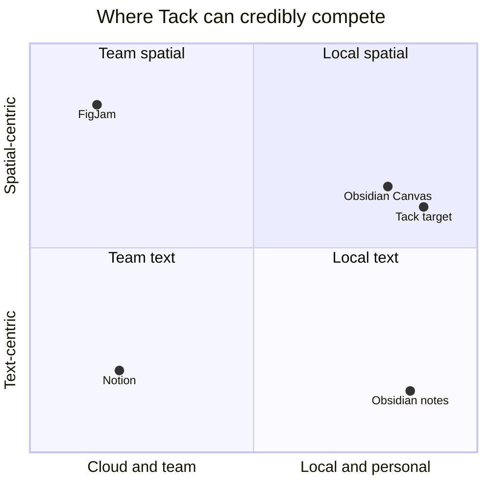

# 02 — Competitor Analysis: Notion, Obsidian, Figma / FigJam

> Method: primary sources fetched during this review (Notion help centre and release notes, Obsidian site pages, Figma help centre, jsoncanvas.org). Where a primary page could not be retrieved, the claim is labelled **[Background]** (my prior knowledge, not re-verified now) and should be re-checked before it is quoted externally.
>
> Labels: **[Verified]** primary source read this session · **[Background]** prior knowledge, unverified now · **[Hypothesis]** my design opinion, not a competitor fact.
>
> Not retrievable this session: Obsidian help-centre pages (`/help/...` rendered no text), Notion in-app design tokens. See the caveat on `DESIGN.md` in §5.

---

## 1. Notion

### 1.1 What it is, verified
- **Every database row is a page.** Items carry typed properties (dates, status, links), and the same data can be shown as table, list, calendar, chart, board or gallery; a database can have any number of views with their own filters, sorts and grouping. [Verified: notion.com/help/intro-to-databases]
- **Pages open in a peek preview** and can expand to full page; page properties sit at the top, free-form blocks below. [Verified]
- **Backlinks are shown on the page** with three display modes: expanded, popover (count only), off. Properties can be "always show / hide when empty / always hide". [Verified]
- **Database items can be created from many entry points** (blue New button, `+ New` at the bottom of a table/list/board, hover `+` on a calendar day). [Verified]
- **Template gallery:** "over 10,000 templates"; a template is just a page that can be duplicated. [Verified: notion.com/help/guides/the-ultimate-guide-to-notion-templates]
- **Offline mode shipped in Notion 2.53 (19 Aug 2025).** Pages must be downloaded per device; on paid plans recents/favourites auto-download; sub-pages are not auto-downloaded; the first 50 rows of a database's first view download; embeds, AI blocks, forms and buttons are unavailable offline. [Verified: notion.com/releases/2025-08-19, notion.com/help/use-pages-offline]
- **Third-party report (not Notion):** on mobile, offline edits sync only over Wi-Fi. [Verified as a claim made by thomasjfrank.com; not confirmed by Notion's own page I read]

### 1.2 Why it succeeds [Hypothesis, supported by the above]
1. **One primitive (the page) composes into everything** — notes, tasks, projects, wikis. Users learn one object.
2. **Structure is optional and incremental.** A page can stay a page, or gain properties, or become a row.
3. **Views separate data from presentation**, so the same set of items answers different questions.

### 1.3 Friction points relevant to Tack [Hypothesis]
- Capture is a *page-creation* act inside a hierarchy; on a phone that means choosing a location before writing. (Notion's offline docs show you must opt pages in per device, which adds ceremony for a "write it down now" use.)
- The database-view system is powerful and a large mental model; most of Tack's value does not need it.
- Network-dependent blocks (embeds, buttons, AI, forms) are unavailable offline — an inherent cloud trade-off, not a flaw, but it is exactly Tack's opposite.

### 1.4 Worth borrowing
| Pattern | Why | Tack adaptation |
|---|---|---|
| **Properties on a page** | Structure without a separate database tool | Already half-built as YAML frontmatter; fix the dual edit surface |
| **"Hide when empty" property display** | Keeps pages calm | Apply to the properties header |
| **Backlinks display modes (expanded / count popover / off)** | Backlinks are valuable but noisy | Default to count chip on mobile, expand on tap |
| **Peek before open** | Fast triage | Long-press → peek sheet for notes and boards |
| **Slash menu as the insertion model** | Already adopted | Consolidate toolbar + slash into one menu |
| **Templates as ordinary pages** | Users can author them | Keep custom templates; allow "save this note as template" (exists) |

### 1.5 Deliberately avoid
- Database-as-primary-navigation, formulas, relations/rollups.
- Workspace/teamspace hierarchy, sharing and permission UI.
- Marketing-site decoration (character marks, big display type) inside the product UI.

---

## 2. Obsidian

### 2.1 What it is, verified
- **Principles (site manifesto):** Yours, Durable ("simple, open file formats that prevent lock-in"), Private ("data is stored on your device"), Malleable ("highly customizable and extensible"), Independent ("100% supported by our users, not investors"). [Verified: obsidian.md/about]
- **Mobile:** free on iOS and Android; tabs, command palette, plugins and custom hotkeys are present; **graph view and other core plugins work the same**; customizable toolbar and touch gestures. [Verified: obsidian.md/mobile]
- **Canvas:** infinite space; cards can be text, Markdown-file embeds, image/video, PDF, webpage, or a nested canvas; canvases can be embedded in notes; connections can be labelled and coloured; groups; snap to grid and to other cards; align/distribute; zoom to fit / selection; export to image. [Verified: obsidian.md/canvas]
- **Canvas file format:** the open **JSON Canvas** format (`.canvas`), MIT-licensed, designed "to provide longevity, readability, interoperability, and extensibility". [Verified: jsoncanvas.org]
- **Backlinks, outgoing links, unlinked mentions, graph:** well-known core features. [Background: help pages not retrievable this session]

### 2.2 Why it succeeds [Hypothesis]
1. **Trust through ownership** — a folder of Markdown files you can open anywhere.
2. **Linking is cheap** — typing `[[` is the whole feature.
3. **Extensibility absorbs niche demand** without bloating the core.

### 2.3 Friction points relevant to Tack [Hypothesis]
- Power comes from configuration; a first-time phone user sees an empty vault and a blank file.
- Canvas is general-purpose; it has no typed diagram semantics (decision diamonds, orthogonal routing, auto-arrange) in the core feature list above.
- Capture on mobile depends on plugins/clipper and the user's own vault organisation.

### 2.4 Worth borrowing
| Pattern | Tack adaptation |
|---|---|
| **Open, inspectable data** | Export notes as a folder of `.md` files and boards as `.canvas` (JSON Canvas). See `08-technical-architecture-review.md` |
| **Cards that are notes on a canvas** | Already exists as spec cards; deepen it, don't re-invent |
| **Align / distribute / snap / zoom-to-selection** | Missing on the Tack board; low-cost, high-perceived-quality |
| **Backlink + unlinked-mention panel** | Already built; keep |
| **Command palette** | On Android: a global "Do anything" sheet reachable from search |

### 2.5 Deliberately avoid
- Plugin architecture and theme marketplace.
- "Vault" as a user-facing concept on first run.
- Sync service (Tack stays device-local until proven otherwise).

---

## 3. Figma / FigJam

### 3.1 What FigJam is, verified
- An online whiteboard for brainstorming, diagrams and mind maps; "lightweight, inclusive environments". [Verified: help.figma.com Guide to FigJam]
- **One infinite board with a dot grid;** pan with Space-drag or two-finger slide; zoom with ⌘/Ctrl+scroll or pinch; zoom level in the corner. [Verified: Explore FigJam files]
- **Sticky notes:** text only; random colour per file open, changeable; **quick create** next sticky with ⌘/Ctrl+Enter; duplicate with ⌘/Ctrl+D or Alt-drag; shortcuts `S` (sticky), `X` (bent connector), `L` (straight connector). [Verified: Sticky notes in FigJam]
- **Connectors:** bent, curved or straight; end points re-attach by dragging. [Verified]
- **Sections:** cluster and move objects together, can be locked (all, or background only), hidden, linked to, titled; templates can be applied to a section. [Verified: Organize with sections]
- **Quick actions bar** (⌘/Ctrl+`/`), **pages** inside a file, tables, code blocks, find-and-replace, mind maps, import from Miro/Mural/Lucid/Jamboard, export, iPad app, screen-reader guide, accessible-board guide. [Verified: FigJam help index]
- **Meeting tools:** timer, voting, spotlight, stamps/emotes, cursor chat, audio. [Verified: help index]
- **Figma design system machinery** (components, variants, variables/tokens, auto layout): [Background; I did not fetch these pages]

### 3.2 Why it succeeds [Hypothesis]
1. **Direct manipulation is the whole interface**: create-by-hovering, connect-by-dragging, quick-create-next.
2. **Sections give structure without rules.**
3. **Keyboard shortcuts and a command bar make power users fast** while the toolbar serves novices.

### 3.3 Friction points relevant to Tack [Hypothesis]
- Built around collaboration; solo "private thinking" is not its centre.
- Stickies are text-only [Verified], so long-form thinking happens elsewhere.
- Online, account-based product.

### 3.4 Worth borrowing
| Pattern | Tack adaptation |
|---|---|
| **Quick-create-next** | "Add sibling/child node" from a selected node (Tack already has branch (+) handles; formalise as the primary creation gesture) |
| **Sections** | Replace ad-hoc colour-coding on the board with a labelled region that moves its contents |
| **Selection model** (shift-select, marquee, group, lock) | Tack has none of multi-select, group, lock or z-order [Verified in whiteboard audit] — this is the biggest board interaction gap |
| **Connector re-attachment by drag** | Tack picks ports by heuristic; allow drag-to-reattach |
| **Command bar** | Same "Do anything" sheet as Obsidian row |
| **Accessible-board guidance** | Tack has zero `Semantics` on the board; FigJam publishes both screen-reader and accessible-board guides, so this is a recognised expectation |

### 3.5 Deliberately avoid
- Real-time cursors, voting, timer, stamps, audio.
- Free-form drawing and ink (Tack has no freehand tool today; adding one is a large scope jump).

---

## 4. Comparative matrix

| Capability | Notion | Obsidian | FigJam | **Tack today** [Verified in code] |
|---|---|---|---|---|
| Primary unit | Page/block/database | Markdown file | Board object | Markdown note **and** board |
| Works fully offline | Opt-in per page, per device (since Aug 2025) | Yes (local files) | No (online product) | **Yes, always** |
| Account required | Yes | No (Sync/Publish optional) | Yes | **No** |
| Linking and backlinks | Backlinks on page | Wiki links, backlinks, graph | Link to sections/objects | Wiki links, backlinks, unlinked mentions, graph |
| Spatial canvas | No (database views only) | Canvas, free-form cards | FigJam board, free-form | Typed flowchart board with orthogonal connectors |
| Note ↔ canvas link | Not applicable | Cards can be notes; canvas embeddable in notes | Not applicable | Spec cards ↔ notes; `![[Board#node]]` embeds |
| Open data format | Proprietary | Markdown + JSON Canvas | Proprietary | **JSON blob in SharedPreferences; PNG/JPG/PDF/Markdown export** |
| Phone-first capture entry points | App + web clipper | Mobile app, clipper | iPad app | **Share, text-selection, QS tile, widget, shortcuts, `.md` open** |
| Collaboration | Core | Via Sync/Publish | Core | None |
| Templates | 10,000+ gallery | Community/plugins | Built-in + custom | 6 built-in + custom |
| Accessibility posture | Not assessed | Not assessed | Publishes screen-reader guides | **0 `Semantics` on board and editor; tap targets <48dp in many controls** |

---

## 5. Caveat about the supplied `DESIGN.md`

The attached `DESIGN.md` is titled "Notion — Style Reference" and states that "source measurements are normalized; roles and recommendations are interpreted." Its content (hero highlight pill, logo wall, "feature cards", 1440px page width, 64px top nav) describes **Notion's public marketing website**, not the in-app product. In-app measures (sidebar width, block spacing, hover affordances, menu geometry) are **not in that file** and I could not retrieve them from a primary source. So:

- Its colour, type and surface philosophy is a legitimate *mood reference* (paper-warm canvas, hairline borders instead of shadows, one chromatic action colour, hierarchy by alpha).
- Its numbers are not a spec for a mobile app UI. `07-design-system.md` proposes Tack's own values and labels which ones are informed by that reference.
- Several of its own values fail accessibility if copied: `#757575` secondary text on `#f6f5f4` is **4.23:1** (below 4.5:1 for body text), and white on `#f6d5b8`-style pastels is not usable for text. [Verified by calculation]

---

## 6. Opportunity map

(Positions are my qualitative placement, a **[Hypothesis]**, not a measurement.)

Gap statement: **local, personal, phone-native, with a *typed* flowchart surface tied to written notes.** Obsidian is the nearest, but its Canvas is untyped and its mobile capture is vault-centric.

---

## 7. Summary of recommendations

| Adopt | Modify | Reject |
|---|---|---|
| Properties-on-page (as frontmatter, one edit surface) | Peek-before-open → long-press peek sheet | Databases, formulas, relations |
| Backlink display modes | Command bar → single "Do anything" sheet | Collaboration, comments, permissions |
| Open data export (Markdown + JSON Canvas) | Quick-create-next → branch handles as the primary board gesture | Plugin system |
| Align/distribute/snap/zoom-to-selection on board | Sections → labelled regions on board | Meeting/workshop tools |
| Selection model on board | | Marketing-site decoration in product UI |
