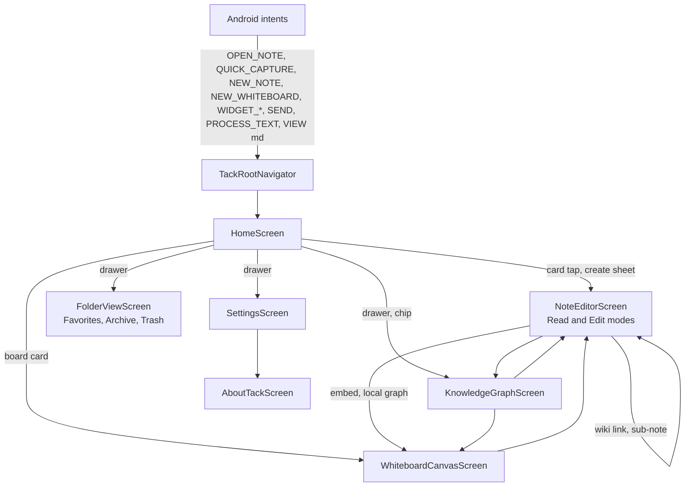

# 03 — Existing UI Audit

> Scope: every screen, reusable widget, sheet, dialog and menu in the current Flutter app, plus the Android surfaces. Nothing was modified or deleted.
>
> Method: full read of navigation, state, theme and native code by me; large screens (whiteboard, editor and knowledge layer, home/settings/components) were inspected file-by-file by three read-only sub-agents. I independently re-verified the highest-impact claims (Archive unreachable, quick-capture toggle unreachable, backup uses filtered list, `AGENTS.md`/`AUDIT.md` drift). Everything not re-verified is labelled **[Reported]** (sub-agent finding with file:line, not re-read by me) or **[Inferred]**.
>
> **`AUDIT.md` is stale.** It describes `MainNavigationShell`, SQLite, `HomeViewMode`, `SmartNoteListCard` and a Compact List View setting. None exist in the current code, and its compile errors in `test/` have been fixed. This document supersedes it.

---

## 1. Screens and routes

### 1.1 Real navigation graph [Verified]

Seven screens total. `StickyNote` and `ClipboardItem` have **no screen of their own**; both open in `NoteEditorScreen`.

### 1.2 Screen inventory

| # | Screen | File | Lines | Purpose | Notes |
|---|---|---|---|---|---|
| 1 | Home | `ui/screens/home/home_screen.dart` | 834 | Feed grid, search, sort, filters, create | Doubles as "Notes", "Whiteboard", "Clipboard" via a category filter. `Home` and `Notes` tabs render the same widget |
| 2 | Note editor | `ui/screens/editor/note_editor_screen.dart` | 2,731 | Read mode + Edit mode for notes, stickies, clips | God widget: formatting, find/replace, tags, sub-notes, export, backlinks |
| 3 | Whiteboard | `ui/screens/whiteboard/whiteboard_canvas_screen.dart` | 5,139 | Flowchart canvas | ~4,700-line state class, 71 `setState` calls, no tests [Reported] |
| 4 | Knowledge graph | `ui/screens/graph/knowledge_graph_screen.dart` | 959 | Global and 1-hop graph | Synchronous O(N²) force layout in `build` [Reported] |
| 5 | Folder view | `ui/screens/folders/folder_view_screen.dart` | 187 | Favorites / Archive / Trash | Archive cannot be populated (see §6) |
| 6 | Settings | `ui/screens/settings/settings_screen.dart` | 974 | Theme, backup/restore, counts, about, release notes tab | Two read-only "preference" tiles that are not preferences |
| 7 | About | `ui/screens/settings/about_tack_screen.dart` | 616 | "Stack & Journey", "Open Source" tabs | Hardcoded marketing copy; says Flutter SDK 3.29.0 while `pubspec.yaml` says `^3.13.1` |
| – | Release notes tab | `ui/screens/settings/release_notes_tab.dart` | 560 | Changelog | Still advertises "Grid ↔ List switcher" |

### 1.3 Navigation chrome
- **`AppHeaderBar`** — avatar (opens drawer), static greeting "Welcome back 👋 / Workspace", search toggle, **theme toggle**. `onQuickCreate` and `userName` parameters are unused. [Reported]
- **`SmartBottomNavBar`** — Home, Notes, centre (+) FAB, Whiteboard, Clipboard. Handler index 2 is unreachable. Header and bar auto-hide on scroll.
- **`AppNavDrawer`** — Today's Note, Knowledge Graph, All Notes, Favorites, Archive, Trash, user folders (long-press to delete), Settings, footer "Version 2.0.0". Version string is hardcoded in four places.
- **Back handling on Home** closes drawer → search → category, in that order.

---

## 2. Component inventory

### 2.1 Cards
| Component | Used for | Issues |
|---|---|---|
| `NeoNoteCard` | notes, boards, and all items in Folder view | Emoji + 2-line title + ordinal date + 4-line summary + glyph by tag; press scale animation. Bottom glyph is chosen by tag (`fitness→bolt`, `work→briefcase`…) with hardcoded tag names |
| `StickyNoteCard` | `StickyNote` only | Adds its own `Transform.rotate` on top of the grid's per-card rotation |
| `ClipboardCard` | clips | Copy pill hit area ~12 dp of vertical padding (<48 dp) |
| Whiteboard preview in embeds | `![[Board]]` | `_MiniWhiteboardPreviewPainter` draws every node as a rounded rect; decision/IO shapes not represented; straight centre-to-centre edges |

There is **no board thumbnail** on the Home card; boards are shown with a glyph and "N nodes, M connections".

### 2.2 Sheets, dialogs, menus [Verified from file list; counts Reported]

**Bottom sheets (≈17):** `CreateItemSheet`, `NoteActionSheet`, move-to-folder (raw `showModalBottomSheet`), `SlashCommandSheet` (Insert + Turn Into tabs), `DocumentOutlineSheet`, `NoteStatisticsSheet`, `MarkdownTableEditorSheet`, `MermaidTemplateSheet`, `FrontmatterEditorSheet`, emoji picker, colour picker, callout picker, image-source picker, export & share, whiteboard-embed picker, whiteboard export, whiteboard spec-card pin sheet.

**Dialogs:** save-as-template, image URL, new folder, restore backup (paste JSON), empty-trash confirm, whiteboard edit-text, whiteboard edge label.

**Menus / popups:** `IosThreeDotMenu` (editor), `TackDropdown` (sort, folder), whiteboard shape menu, node capsule, edge capsule, grid-opacity slider popup, minimap.

**Observation:** `AppBottomSheet` exists and is correct (single drag handle, keyboard inset, 90 % max height) but several sheets still call `showModalBottomSheet` directly (e.g. move-to-folder). [Reported]

### 2.3 Inputs and feedback
- `AppSearchField` (clear button 44×44, `Semantics` label), `CategoryFilterPills` (folder dropdown + tag strip), `ColorSwatchPicker` (38 dp swatches).
- `TackToast` plus a **second, hand-rolled snackbar** in `main.dart` with the same look. The editor additionally uses stock `SnackBar` in four places.
- `EmptyStateWidget` shows the red mascot (`icon.png`) regardless of the icon argument.

### 2.4 Android surfaces [Verified]
| Surface | File | Behaviour |
|---|---|---|
| Share target | `AndroidManifest.xml` | `SEND` / `SEND_MULTIPLE` for text, markdown, images |
| "Save to Tack" | `ProcessTextActivity` alias | System text-selection menu |
| Open `.md` / `.markdown` / `.txt` | `VIEW` filters | Imports as a note |
| Quick Settings tile | `TackQuickCaptureTileService.kt` | One-tap blank note |
| 3×3 widget | `TackQuickActionWidgetProvider.kt` | Three buttons: "Worth remembering…", "Done with your works?", "Plan your day" → pre-filled notes |
| App shortcuts | `shortcuts.xml` + dynamic shortcuts | New note, new board, 2 recent/favourite notes |
| Persistent quick-capture notification | `MainActivity.kt` | **No UI to enable it** |
| Single `MethodChannel` | `com.notes.tacknotes/process_text` | Methods: `getInitialText`, `showQuickCapture`, `hideQuickCapture`, `updateShortcuts`; event `onReceiveText` |

---

## 3. Visual system as built

### 3.1 Typography
- `AppTypography` is now consistently **DM Sans** via `google_fonts`; the "three font families" problem recorded in `AUDIT.md` is fixed. [Verified, lines 1–120]
- Code uses `GoogleFonts.jetBrainsMono` directly, outside the token layer. [Reported]
- **No fonts are bundled** (`pubspec.yaml` has no `fonts:` section, only `icon.png` and `icons/`). `google_fonts` downloads at runtime by default, so **a first launch without network falls back to the system font** — a direct conflict with a local-first promise. [Verified pubspec; behaviour Inferred]
- 279 inline `TextStyle(` occurrences in `lib/ui` + `main.dart`; 191 of them set `fontFamily: AppTypography.fontFamily` instead of using the theme. [Reported]

### 3.2 Colour
- Tokens exist in `AppColors`: light surface `#F8F9FA`, card `#FFFFFF`, ink `#191A23`; dark surface `#121316`, card `#1E1F24`; 8 pastel palettes with `light`, `dark`, `soft`, `index` and `pin` variants.
- **344 hardcoded `Color(0x…)` occurrences** in `lib/ui` + `main.dart`; 82 are the single value `0xFF191A23` (which is already `AppColors.lightTextPrimary`). Worst files: `mermaid_diagram_card` (44 lines), `whiteboard_canvas_screen` (29), `rich_note_content_view` (25), `slash_command_sheet` (24), `create_item_sheet` (16). [Reported]
- **The palette in code does not match the palette documented in `AGENTS.md`.** Examples [Verified]:

| `AGENTS.md` | Code |
|---|---|
| Sunset Peach `#FF8F6B` | `#F3916A` |
| Warm Amber `#F5B842` | `#FFC661` |
| Lavender Mist `#9D84D6` | `#A88FE3` |
| Slate Pure `#E2E8F0` is palette #8 | `pastelSlateLight` exists, but is **not** in `presetPalettes`; the whiteboard asks for `'slate'`, which falls back to peach [Reported] |
| 8 listed: Peach, Amber, Coral, Lavender, Cyan, Lime, Rose, Slate | 8 in code: Amber, Peach, **Terracotta**, **Yellow**, Lavender, Coral, Cyan, Lime. Terracotta (`#F0906A`) vs Peach (`#F3916A`) and Yellow (`#F7C167`) vs Amber (`#FFC661`) are near-duplicates |

- **Brand red is absent.** The launcher icon is saturated red; the UI has no red anywhere except `error` (`#F56767`). [Verified]
- **Contrast** (computed): ink `#191A23` on pastel light fills ranges 5.78:1 (Coral) to 13.6:1 (Lime) — all pass AA. `lightTextMuted #646A77` on `#F8F9FA` = 5.15:1 (passes). The old failing tertiary colour `#9CA3AF` (2.41:1) was fixed. **The `indexColor` accents used for bullets, inline-code text and numbering in light mode fail 4.5:1 on white for Peach (3.76), Cyan (4.30) and Lime (3.03).** [Verified by calculation; usage as text Inferred]

### 3.3 Spacing, radii, shadows
- `AppSpacing`: 4/8/12/16/24/32/48; radii 8/16/24/32/pill; three light shadow recipes, one dark. [Verified]
- In practice radii of 6, 10, 12, 13, 14, 18, 20 appear inline; whiteboard alone has 52 `BorderRadius.circular` + 62 `Radius.circular`; shadows are re-specified inline (8 in whiteboard). `bottomMargin: 88` (toast offset) is a magic number repeated across callers. [Reported]
- Cards rotate (`Transform.rotate`), and the right column of the home grid starts 38 dp lower — a deliberate "tactile" gesture, but it breaks vertical alignment and costs layout/paint without lazy building. [Reported]

### 3.4 Icons
- `TackIcon` wraps **`lucide_icons_flutter`** plus 18 custom SVGs in `icons/`. **`heroicons` is not a dependency.** `HeroIconStyle` is a local enum; `TackIcon.style` is declared and never read. [Verified]
- Raw Material `Icons.*` still appear ~52 times in the whiteboard and ~30 elsewhere; `LucideIcons.*` is used directly in 14 UI files, bypassing the wrapper. [Reported]
- Semantic mismatches: sort button uses a "list view" icon; the "Saving…" pill uses an *undo* icon; settings navigation tiles use a *chevron-down* as a forward chevron. [Reported]

### 3.5 Themes
Light/Dark/System persisted under `app_theme_mode`. Default on first launch is **Light**, not System. The header has a theme toggle that duplicates the Settings selector. Edge-to-edge overlay brightness is now handled in `TackApp` (fixed since `AUDIT.md`). [Verified]

---

## 4. States: loading, empty, error

| State | Present? | Evidence |
|---|---|---|
| Loading | Spinner on Home only when `loadItems` runs with an empty list | `home_screen.dart:356` [Reported] |
| Empty | Mascot + title + CTA on Home | `EmptyStateWidget` |
| Empty (Trash/Archive/Favorites) | Yes in Folder view | [Reported] |
| **Error** | **None anywhere.** Storage failure is `debugPrint` only | `workspace_repo_impl.dart:136-140` [Verified] |
| Corrupt-store recovery | If `jsonDecode` throws, the `catch` seeds welcome data in memory only; the **next save overwrites the unreadable blob** and no copy of it is kept. Items that individually fail `ItemSerializer.fromJson` are skipped silently, and the next save drops them permanently | `workspace_repo_impl.dart:47-88` [Code Verified; user-visible consequence Inferred, needs a test] |
| Offline | N/A (local) | – |

---

## 5. Responsiveness and accessibility

### 5.1 Responsive
- No breakpoints, no `LayoutBuilder` in screens or components (only inside Mermaid and whiteboard code), no landscape/tablet layout. Home is always 2 columns; Folder view uses fixed `mainAxisExtent: 220`. [Reported]
- Home card height scales with text scale (`220 × clamp(1.0, 1.45)`); the create-sheet template strip scales too. Everything else uses fixed heights (toolbar 48, slash bar 46, tag strip 48, swatch row 58). [Reported]
- Editor has **no max content width**, so on tablets and landscape lines run full-width. [Reported]
- Whiteboard assumes touch: edge-zone logic for the back gesture, pointer counting. Desktop mouse (hover, right-click, scroll-wheel zoom) not designed. [Reported]

### 5.2 Accessibility
- Only **2 `Semantics` widgets** in all of `lib/` (search clear button; sheet drag handle). Whiteboard: **0**. Editor/reader/graph/Mermaid: **0**. [Reported]
- 70 tooltips across 49 `IconButton`s; bottom-nav FAB has none. [Reported]
- Touch targets below 48 dp: formatting toolbar 38; whiteboard dock 36, capsule buttons 32, resize/branch handles 28–30; find-bar buttons 28; table-editor icons 28; tag chips ~30; toast action ~8 dp padding; copy pill ~12 dp padding; three-dot menu 36. [Reported]
- Whiteboard capsules and handles sit **inside the scaled canvas**, so on-screen size varies from tiny (0.15×) to huge (3.5×); effective hit area is below 48 dp at most zoom levels. [Reported]
- Text scale: node text uses fixed font sizes in fixed boxes with no `maxLines`/`overflow`. [Reported]
- Ripple: ~10 interactive surfaces use `GestureDetector` with no pressed feedback (tag pills, chips, theme segments, template cards, swatches, toast action). [Reported]
- Colour is the only differentiator among pastel palettes for node/note colour. [Reported]

---

## 6. Redundancy and dead functionality

| Item | Evidence | Locked Decision #2 (no redundant controls) |
|---|---|---|
| **Today's Note** reachable from Home chip, drawer, create sheet, widget, shortcut | [Verified/Reported] | Violated |
| **Graph** from Home chip and drawer | [Reported] | Violated |
| **Favorites** from the Home folder dropdown (filters in place) *and* the drawer (pushes a different screen) | [Reported] | Violated; different behaviour |
| **Theme** toggle in header and in Settings | [Reported] | Violated |
| **Empty Trash** in Folder view and in Settings | [Reported] | Violated |
| **Instant Blank Note** vs create sheet → Note → Blank → Create | [Reported] | Violated |
| **Sub-note** "+" chip and "+ New" in the Sub-notes section (both create a sub-note) | [Reported] | Violated |
| `/` and `⇄` toolbar buttons open the same sheet | [Reported] | Violated |
| Raw YAML in the editor *and* the properties bar edit the same data | [Reported] | Two editing surfaces |
| **Home vs Notes tab** render the same screen | [Reported] | Violated |
| **Archive** | `toggleArchive` has no UI caller; drawer shows "Archive" | Dead end [Verified] |
| **Quick-capture notification toggle** | no UI sets it | Dead feature [Verified] |
| "Tactile Haptic Feedback — Active", "Offline-First Privacy — Local" tiles in Settings | read-only text styled like settings | Misleading [Reported] |
| `IStorageDriver` | never implemented or imported | Dead abstraction [Verified] |
| `ItemType.sticky` branches in nav-index and headline code | `setCategory(ItemType.sticky)` never called | Dead [Reported] |

---

## 7. Bugs and risks discovered while auditing

Severity: **P0** data loss/security · **P1** broken behaviour · **P2** polish.

| Sev | Finding | Evidence |
|---|---|---|
| **P0** | Backup export serialises `_items`, which `loadItems()` overwrites with the category/search-filtered list; trash and archive are excluded | `workspace_provider.dart:116-126, 736-751` [Verified] |
| **P0** | Renaming a note silently breaks inbound `[[links]]` | no rename propagation [Verified by grep] |
| **P0** | Entire workspace JSON rewritten to one SharedPreferences string on every save (also on every whiteboard drag end, 30 call sites) | `workspace_repo_impl.dart:131-141`, whiteboard [Reported] |
| **P1** | Today's Note lookup reads filtered `_items`; from a filtered view it may create a second note with the same id and overwrite | `workspace_provider.dart:520` [Reported] |
| **P1** | Find & Replace: case-insensitive search but case-sensitive Replace All; no scroll-to-match; useless in Read mode | `note_editor_screen.dart:1097-1174` [Reported] |
| **P1** | No lifecycle flush in editor; last 600 ms of typing at risk | [Inferred] |
| **P1** | Per-keystroke work is O(total workspace text): backlinks over all notes recomputed in `build` | `note_editor_screen.dart:1628-1631` [Reported] |
| **P1** | Mermaid card wraps its viewer in `IgnorePointer`; pan/zoom promised in docs cannot work | `mermaid_diagram_card.dart:279` [Reported] |
| **P1** | Table editor strips inline Markdown by default, so editing a table silently drops bold/code | `markdown_table_service.dart:52-64` [Reported] |
| **P1** | Markdown export prepends `# title` before frontmatter, so frontmatter is no longer at line 0 | `note_export_service.dart:26-34` [Reported] |
| **P1** | Search matches title + 90-char summary + tags only, **not note bodies** | `base_item.dart:76-81`, `text_note.dart:33-60` [Verified] |
| **P1** | Search runs through `loadItems()` without debounce and replaces the master list | `workspace_repo_impl.dart:198-206` [Reported] |
| **P1** | Welcome note tells new users to create a "Clip" via (+); the sheet only offers Note, Sticky, Whiteboard | `mock_initial_data.dart:23` [Reported] |
| **P2** | Whiteboard viewport never persisted; spec-card embed references board by *title*, so renaming breaks it | [Reported] |
| **P2** | Whiteboard image nodes: absolute paths, never deleted, no downscaling | [Reported] |
| **P2** | Tests use `GoogleFonts` and `find.bySemanticsLabel` without `ensureSemantics()`; may fail at runtime | [Inferred] |

---

## 8. Classification of every feature

| # | Feature / component | Verdict | Rationale |
|---|---|---|---|
| 1 | Markdown note model, Read/Edit modes, 600 ms autosave | **KEEP** | Core; matches Locked Decision #3 |
| 2 | Editor chrome (app bar, toolbar, find bar, tag bar, breadcrumb, sub-notes card, frontmatter bar) | **REDESIGN** | Too many bars competing; 38/36/28 dp targets |
| 3 | Find & Replace | **REDESIGN** | Case mismatch; must work in Read mode; scroll-to-match |
| 4 | Undo/redo for text | **REDESIGN** | No UI; behaviour unverified |
| 5 | Wiki links, backlinks, unlinked mentions | **KEEP** | Real differentiator |
| 6 | Link resolution by **title** | **REDESIGN** | Store stable ids, display titles |
| 7 | Knowledge graph (global) | **RECONSIDER** | Rarely actionable on a phone; O(N²) on UI thread. Keep *local* (1-hop) graph |
| 8 | Local graph (1-hop) | **KEEP** | Useful and cheap |
| 9 | Slash command sheet + toolbar `/` + `⇄` + Turn-Into | **MERGE** | One insertion/transform menu |
| 10 | Formatting toolbar | **REDESIGN** | Fewer, bigger targets; add undo/redo; H3 |
| 11 | Frontmatter properties bar | **REDESIGN** | One editing surface; keep typed pills |
| 12 | Tables (visual editor) | **KEEP**, fix | Preserve inline formatting; wrap cells |
| 13 | Mermaid (parser, card, templates, completion bar ≈3.2k lines) | **RECONSIDER** | Overlaps whiteboard. Keep flowchart render + "Convert to board"; freeze or drop pie/timeline/sequence pending usage |
| 14 | Code blocks | **KEEP** | Generic highlighter ignores fence language |
| 15 | Templates (6 + custom) | **KEEP** | Expresses the niche; prune and re-order |
| 16 | Daily note + carry-forward tasks | **KEEP** | Anchor for a Today surface |
| 17 | Sub-notes (`parentId`) | **RECONSIDER** | Overlaps folders and tags |
| 18 | Folders (string names) | **RECONSIDER** | Three organising systems: folders, tags, sub-notes |
| 19 | Tags (`TextNote.tags`, `#tag` styling) | **REDESIGN** | Inline `#word` is styled but not indexed; seeded fake tags `#work #Personal #Fitness` always shown |
| 20 | Whiteboard (core canvas, nodes, connectors) | **KEEP** | Differentiator |
| 21 | Whiteboard implementation | **REDESIGN** | Extract painters/controllers; culling; debounce save; selection model; 48 dp controls; Semantics |
| 22 | Whiteboard Zen mode, grid-opacity slider, minimap, auto-align, fit | **REDESIGN** | Five overlapping view controls; keep Fit + Auto-arrange + minimap on demand |
| 23 | Spec cards (board ↔ note) | **KEEP** | Core of the note ↔ spatial promise |
| 24 | Board export (PNG/JPG/PDF) | **KEEP**, cap size | Unbounded bitmap size |
| 25 | `![[Board]]` embeds | **KEEP** | – |
| 26 | Sticky notes as an item type | **MERGE** | Same editor, same storage as notes; keep colour + "pin" presentation |
| 27 | Clipboard item type + Clipboard tab | **RECONSIDER** → fold into Inbox | Not a clipboard manager; platform limits |
| 28 | Search | **REDESIGN** | Full-text, ranked, debounced, grouped; global |
| 29 | Home screen controls (greeting, theme toggle, 2 quick chips, headline sort) | **REDESIGN / REMOVE** | Greeting static; chips duplicate drawer |
| 30 | Home vs Notes tab | **MERGE** | Same screen |
| 31 | Bottom nav (5 slots with fake destinations) | **REDESIGN** | See `05-information-architecture.md` |
| 32 | Navigation drawer | **REDESIGN** | Keep only secondary destinations |
| 33 | Favorites | **KEEP** | One entry point |
| 34 | Archive | **REMOVE** (unless completed) | Cannot be populated; Trash + Favorites cover the need |
| 35 | Trash | **KEEP** | Add confirm on permanent delete and make rows tappable for preview |
| 36 | Create sheet (type chips, templates, title, snippet, folder, colour) | **REDESIGN** | Too much for a capture action; split "Capture" from "New…" |
| 37 | `NoteActionSheet` (long press) | **KEEP**, merge with editor menu | Same actions appear in two places |
| 38 | Settings screen | **REDESIGN** | Remove fake preference tiles; add real ones |
| 39 | About + Release Notes (≈1,180 lines of static copy) | **MERGE / REMOVE** | One "About" with version read from the package; changelog off-app |
| 40 | Backup / Restore | **KEEP**, fix | Unfiltered export; file picker instead of paste; include trash |
| 41 | Android: share target, process-text, `.md` open, QS tile, shortcuts | **KEEP** | Differentiator |
| 42 | Android: widget | **REDESIGN** | Three fixed prompts; make it capture + today's tasks |
| 43 | Android: persistent notification | **RECONSIDER** | Unreachable; QS tile + widget already cover capture |
| 44 | Theme toggle in header | **REMOVE** | Duplicates Settings |
| 45 | Sticky `rotationAngle` / card rotation | **RECONSIDER** | Decoration; breaks alignment |
| 46 | `AppHeaderBar` greeting | **REMOVE** | Static text with unused `userName` |
| 47 | `TackToast` + hand-rolled snackbar + `SnackBar` | **MERGE** | One feedback component |
| 48 | `IStorageDriver` | **REMOVE or implement** | Dead abstraction (also documented as a pillar) |
| 49 | `MockInitialData` seed content | **REDESIGN** | Teach the real loop; fix the "Clip" instruction |

---

## 9. Desktop vs mobile

Desktop is **not designed**; only scaffolds exist. The design-relevant gaps if desktop ever matters: no hover/focus states, no keyboard shortcuts in the editor, no max content width, no multi-pane layout, no context menu, no resizable sidebar. Treat as a Figma exploration, not a v1 requirement (see `09-redesign-roadmap.md`).
