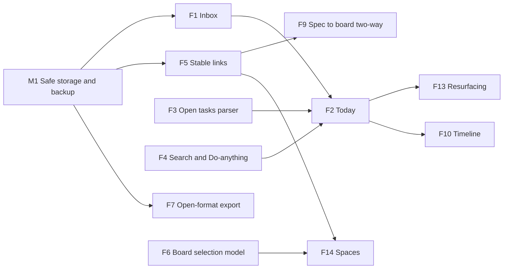

# 04 — Feature Strategy

> Every proposal here is a **candidate**, not a requirement. "Exists" means verified in code (`03-existing-ui-audit.md`). "Proposed" means new.
> Rule applied: a feature must pass at least two tests from `01-product-analysis.md` §6 (Android-native advantage · note↔spatial link · local-first trust · phone-ergonomic). Anything that adds surface area without passing is rejected.

---

## 1. Strategy in one paragraph

Tack's *existing* strengths (capture ingress, Markdown, wiki links, typed board, spec cards) are ahead of its *surfaces*. The redesign should therefore spend most of its effort on **(a)** making the existing loop trustworthy (data safety, search, link stability, accessibility), **(b)** giving the loop a front door ("Today" and an unprocessed "Inbox"), and **(c)** removing overlapping concepts (sticky, clipboard-as-manager, archive, Home/Notes tab, three organising systems). Only after that should new capability be added.

---

## 2. Historical concepts: verdicts

| Concept | Verdict | Reasoning | What replaces it |
|---|---|---|---|
| **Sticky Notes** | **Merge into Notes** | Same editor, same storage, no distinct surface. Today the only differences are card rotation and an unused `priority` field. | A note can be **pinned** and given a colour; short notes render as compact cards. No separate type in the UI. Migration: map `StickyNote` → `TextNote` (+ pinned) on import. |
| **Whiteboard** | **Keep, rename "Board"** | Most distinctive surface; passes tests 2, 3, 4. | Redesigned (`05`, `07`). |
| **Clipboard** | **Fold into Inbox** | Android blocks background clipboard reads for apps (platform behaviour [Inferred; verify against current Android docs before committing]); the existing feature is a saved-snippet list reached by a manual "paste" button. | Inbox items created by share-in, paste button and capture; Copy remains as an action on any item. |
| **Tasks** | **Derive, don't model** | Tasks already live as `[ ]` Markdown. A separate Task type would fork the data and break the Markdown-as-truth property. | A **derived Open Tasks view** over checkbox lines (see F3). |
| **Smart Actions Menu** | **Replace with one command sheet** | Three separate action surfaces exist (slash sheet, long-press sheet, widget/tile). | One "Do anything" sheet (F4) + one context menu per object. |

---

## 3. MVP: what "Tack 3.0" must contain

MVP = the smallest release that makes the redesigned product coherent and trustworthy. It is **mostly existing functionality re-expressed**, plus five net-new capabilities.

| ID | Item | New or existing | Why in MVP |
|---|---|---|---|
| M1 | **Data safety:** unfiltered, complete backup (incl. trash); never overwrite an unreadable store; atomic writes | Fix | Data-loss class. Cannot ship a redesign on top of it. |
| M2 | **Stable links:** store `[[id]]`-backed links, show titles, propagate rename | Fix | Core promise of linking |
| M3 | **Full-text search** across note bodies, board node text, tags | Fix | Today's search ignores note bodies |
| M4 | **Capture → Inbox** (F1) | New | Fills the biggest journey gap |
| M5 | **Today** (F2) incl. **open tasks** (F3) | New | Turns daily note into a front door |
| M6 | **One insertion/transform menu** (slash + toolbar `/` + Turn-Into) | Merge | Removes duplicate controls |
| M7 | **Accessibility baseline:** 48 dp targets, Semantics on cards/nav/editor, text-scale safe, contrast ≥ 4.5:1 | Fix | Required by the project's own rule; currently unmet |
| M8 | **Design tokens in one place** and consumed everywhere | Fix | Locked Decision #4; today 344 hardcoded colours |
| M9 | **Board performance and selection basics:** save debounce, culling, multi-select, align | Fix + small new | Board is the differentiator and currently drags at O(all nodes) per frame [Reported] |

Everything else below is post-MVP.

---

## 4. Candidate features in detail

Format for each: **Problem · User · Journey · Why existing tools fall short · Complexity · Value · Release.** Complexity: S (days), M (1–3 weeks), L (month+). Dependencies are listed where they matter.

### F1 — Thought Inbox (capture without filing) · **MVP**
- **Problem:** every capture route currently creates a *finished note and opens the editor* (`QUICK_CAPTURE`, `NEW_NOTE`, shares, process-text). The user's follow-up thought is "where did that go?"
- **User:** Persona B (capture-everything), also A mid-thought.
- **Journey:** tile / widget / share / selection → item saved as *Inbox* with timestamp and source app → subtle toast "Saved to Inbox" → user keeps doing what they were doing. Later, **Today** shows "7 to sort"; each item gets: *Keep as note · Add to a note · Make a task · Delete*.
- **Why alternatives fall short:** Notion needs a destination chosen; Obsidian needs a vault folder or plugin; both treat capture and filing as one act.
- **Complexity:** **M.** Needs an `inbox` flag (or state), a triage UI, and changes to Android handlers so they do not force-open the editor. Data model change is small.
- **Value:** High. Strongest use of Tack's Android-native advantage.
- **Dependency:** M1 (safe storage).
- **Risk:** adds a concept (Inbox). Mitigate: it is a *state of an item*, not a place users must manage; zero items = hidden.

### F2 — Today · **MVP**
- **Problem:** Home is an undifferentiated grid sorted by update time; the daily note is hidden behind a chip/drawer entry/sheet button.
- **User:** both.
- **Journey:** open app → **Today**: (1) today's daily note (one tap to write), (2) Inbox count, (3) open tasks due/unchecked, (4) pinned items, (5) optional "worth revisiting" (F13, later).
- **Why alternatives fall short:** Notion Home is a recents list; Obsidian opens last file.
- **Complexity:** **M.** Reuses `openOrCreateTodaysNote` (after fixing the filtered-list bug) and F3.
- **Value:** High. Gives the app a point of view.
- **Dependency:** F3.

### F3 — Open Tasks (derived) · **MVP**
- **Problem:** checkboxes exist, but unchecked items vanish into old notes. The daily-note carry-forward helps only for one hop.
- **User:** A, B.
- **Journey:** Today shows unchecked items from notes updated recently or flagged with a date; tap a task → toggles in place; tap the note name → opens at that line.
- **Why alternatives fall short:** Notion needs a database; Obsidian needs the Tasks plugin; both require setup.
- **Complexity:** **M.** A line-level index over `- [ ]` (code fences excluded; the current checklist test uses `contains('[ ]')` and miscounts [Reported], so the parser must be fixed first). Optional `due:` token (YAML or inline) is a **later** step.
- **Value:** High; makes "Execute" real without new data.
- **Not included:** reminders and notifications (needs `SCHEDULE_EXACT_ALARM` / notification permission design; defer).

### F4 — Search and the "Do anything" sheet · **MVP**
- **Problem:** search finds only titles, 90-char summaries and tags; actions are scattered.
- **Journey:** one entry (search field or `/`-like gesture) → type: results grouped *Notes · Boards · Tasks · Actions* ("New note", "Today", "Export", "Move to folder…").
- **Complexity:** **M.** Needs a body index (in-memory inverted index or SQLite FTS; see `08`). Actions list is static.
- **Value:** High; replaces the Smart Actions Menu concept.

### F5 — Stable links and rename propagation · **MVP**
- **Problem:** links are stored as titles; rename silently breaks them; duplicate titles resolve non-deterministically [Reported].
- **Complexity:** **M.** Migrate `[[Title]]` → internal `[[id|Title]]`-equivalent on write, display title; or keep Markdown `[[Title]]` on disk and resolve through an alias table updated on rename. Decision in `08`.
- **Value:** Very high trust gain.

### F6 — Board selection model and arrange tools · **MVP (basics) / v1.1 (sections)**
- **Problem:** no multi-select, group, lock, align, distribute or z-order [Reported]. FigJam and Obsidian Canvas both offer these [Verified, `02`].
- **Journey:** long-press empty area → marquee; two-finger tap adds; contextual bar: Align, Distribute, Group (Section), Lock, Delete.
- **Complexity:** **L** because it touches the 4,700-line state class; should be done alongside the refactor, not before.
- **Value:** High for Persona A.

### F7 — Open-format export/import · **v1.1**
- **Problem:** data is a JSON blob in prefs. The competitor positioning with Obsidian is "your files" [Verified, `02`].
- **Journey:** Settings → *Export to folder*: `Notes/*.md` (frontmatter intact), `Boards/*.canvas` (JSON Canvas), `Attachments/`. Import the same.
- **Complexity:** **M** for export, **L** for round-trip import. JSON Canvas has text/file/link/group nodes and edges; Tack's typed shapes (decision, I/O) have no direct equivalent and would need an extension field or be flattened [Hypothesis; check the spec before building].
- **Value:** High; durability and trust.

### F8 — Local graph in-note, global graph demoted · **v1.1**
- Keep the 1-hop panel. Move the global graph out of primary navigation and run its layout off the UI thread. Mobile global graphs are rarely actionable [Hypothesis; validate with usage counters].

### F9 — Spec ↔ board two-way · **v1.2**
- **Problem:** spec cards open notes, but you cannot select a heading in a note and drop it as a node.
- **Journey:** in Read mode, long-press a heading → "Add to board…" → picks board → creates a spec card linked to that heading anchor.
- **Complexity:** **M.** Anchor linking already exists (heading anchors).
- **Value:** High and unique to Tack, but only after M2/M6.

### F10 — Timeline of thinking · **Future**
- **Problem:** "Reflect" has no surface.
- **Journey:** a chronological stream of created/edited items and daily notes with filters.
- **Complexity:** **S–M** (data exists: `createdAt`, `updatedAt`).
- **Value:** Medium; defer until the loop is solid.

### F11 — Decision journal · **Template, not a feature**
- A `decision_log` template already exists [Verified]. Do not build dedicated UI. If decisions prove valuable, add a frontmatter `type: decision` and a filter.

### F12 — Focus sessions · **Reject**
- Timers are generic, add no link to notes or boards, and phones already have them. Fails all four tests.

### F13 — Smart resurfacing · **Future (cheap form first)**
- First form: one card on Today — "From N weeks ago" (a note you have not touched) or "Mentioned but not linked" (reuses unlinked-mention logic, which exists [Verified]).
- Do **not** build an AI or scoring system.

### F14 — Contextual project workspaces ("Spaces") · **Future, gated on organising-system decision**
- **Problem:** folders, tags, sub-notes and frontmatter overlap.
- **Journey:** a Space = a note (index) + a board + its linked notes + its open tasks.
- **Gate:** decide the single organising model (see `05`). Do not build Spaces before simplifying folders/tags/sub-notes.
- **Complexity:** **L.**

### F15 — Contextual clipboard · **Reject**
- Depends on background clipboard access that Android restricts; fails tests 1 and 4.

### F16 — "Universal workspace" · **Reject as a goal**
- It is the feature-bloat trap. Tack's coherence comes from a *small, linked* set of objects (note, board, inbox item, task-line).

### F17 — Databases, properties-as-views, relations · **Reject for now**
- The existing frontmatter pills cover light structure. Revisit only if usage shows people filtering by `status`/`priority`.

### F18 — Home widget redesign · **v1.1**
- Three fixed prompts ("Worth remembering…", "Done with your works?", "Plan your day") become: *Capture · Today's open tasks (top 3) · Open Today*. Complexity **S–M** (RemoteViews).
- Keep one Quick Settings tile and drop the unreachable notification.

### F19 — Accessibility pass · **MVP** (see M7)
- Not optional: the project's own rule is 48 dp; 0 Semantics on the board; fixed text boxes.

---

## 5. Dependency graph

---

## 6. Prioritisation table

| Feature | Value | Complexity | Journey stage | Release |
|---|---|---|---|---|
| M1 Data safety | Critical | S–M | all | **MVP** |
| F5 Stable links | Very high | M | Connect | **MVP** |
| F4 Search + command sheet | High | M | Explore | **MVP** |
| F1 Inbox | High | M | Capture | **MVP** |
| F3 Open tasks | High | M | Execute | **MVP** |
| F2 Today | High | M | Execute / Reflect | **MVP** |
| M6 Merge insert menus | Medium | S | Build | **MVP** |
| M7/F19 Accessibility | High | M | all | **MVP** |
| M8 Tokens | Medium | M | – | **MVP** |
| M9 / F6 Board basics | High | L | Build | **MVP (basics)** |
| F7 Open-format export | High | M–L | all | v1.1 |
| F18 Widget redesign | Medium | S–M | Capture | v1.1 |
| F8 Local graph / demote global | Medium | S | Connect | v1.1 |
| F9 Spec↔board two-way | High | M | Build | v1.2 |
| F10 Timeline | Medium | S–M | Reflect | Future |
| F13 Resurfacing | Medium | S | Reflect | Future |
| F14 Spaces | Medium | L | Build | Future (gated) |
| F11 Decision journal | Low | S | Reflect | Template only |
| F12 Focus sessions | Low | S | – | **Rejected** |
| F15 Contextual clipboard | Low | L | – | **Rejected** |
| F16 Universal workspace | – | – | – | **Rejected** |
| F17 Databases/views | Low | L | – | **Rejected (for now)** |

---

## 7. Validation questions per MVP bet

| Bet | Question | Cheapest test |
|---|---|---|
| Inbox | Do captured items sit unprocessed for >1 day? | Add a local counter of "captured vs. opened within 24h" |
| Today | Do users open Today first, or jump to Library? | Prototype in Figma, 5 sessions, first-tap test |
| Open tasks | Do notes actually contain unchecked tasks across many notes? | Read-only script over a few real vaults (developer's own + 3 volunteers) |
| Board basics | Which board interaction fails first? | Moderated board task with 5 users (build a 12-node flow) |
| Merge sticky into notes | Does anyone create stickies? | Count `type == sticky` in exported backups of 5–10 users |
