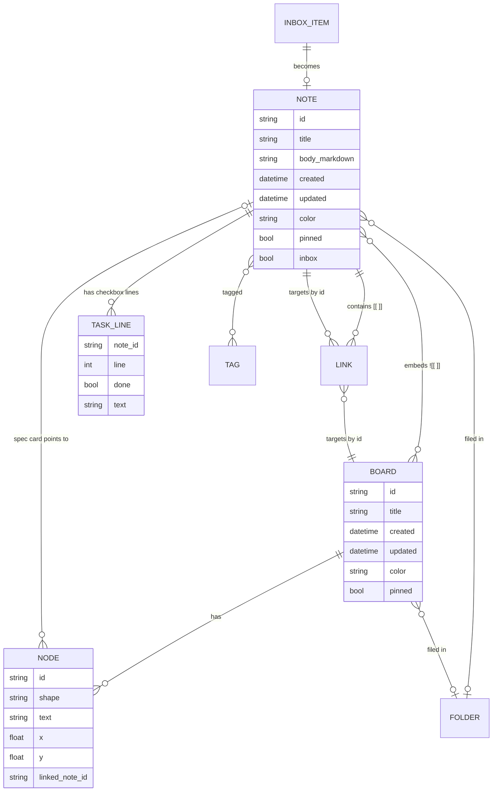
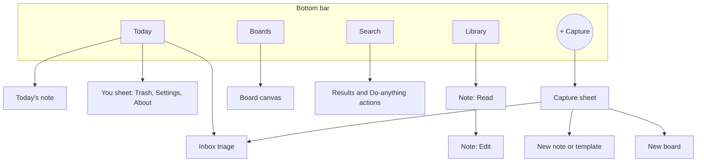
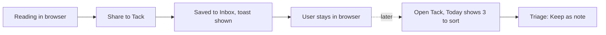

# 05 — Information Architecture

> **Proposed** structure. Current-state facts are labelled "today". Items marked **DECISION** need a product-owner call before Figma freezes; each lists options and a recommended default.

---

## 1. Object model

### 1.1 Today (verified)

`BaseWorkspaceItem` → `TextNote`, `StickyNote`, `WhiteboardCanvasItem`, `ClipboardItem`. Common fields: `id`, `title`, `createdAt`, `updatedAt`, `paletteId`, `isFavorite`, `isArchived`, `isTrash`, `folderName`, `parentId`, `iconEmoji`. Organising mechanisms: **folder name (string)**, **tags** (notes only), **sub-notes (`parentId`)**, **frontmatter properties**, **wiki links**.

### 1.2 Proposed

Key changes and why:

| Change | Reason |
|---|---|
| **Two first-class objects: Note and Board.** Sticky and Clipboard types disappear as separate objects | `04` verdicts |
| **`inbox` is a state flag on a Note,** not a place | Keeps data flat; "Inbox" is a view |
| **`TASK_LINE` is derived, not stored** | Markdown stays the truth |
| **Links target ids** | Rename-safe; titles are display only |
| **`favorite` and `archived` collapse into `pinned`** | Archive is unreachable today; Favorites and "pin to top" overlap |
| **Trash stays as a soft-delete state** | Works today |

### DECISION D1 — one organising model

| Option | What stays | What goes | Trade-off |
|---|---|---|---|
| **A (recommended default)** | **Links + tags + one-level folders** | Sub-notes (`parentId`) as structure; replaced by a "Linked from / Contains" list built from links | Simplest mental model; requires migrating existing sub-note trees to links |
| B | Links + tags + sub-note tree (outline) | Folders | Better for hierarchical specs; weaker for flat collecting |
| C | Keep all three | – | Zero migration, but the confusion remains and Figma has to design three filing UIs |

No usage data exists; ask: *how many items have `parentId`? how many distinct folders?* from 5–10 real exports.

---

## 2. Navigation

### 2.1 Mobile (primary)

| Slot | Contents | Replaces today |
|---|---|---|
| **Today** | Today's note, Inbox count, open tasks, pinned items | Home (undifferentiated grid), two quick chips, drawer "Today's Note" |
| **Library** | All notes in a **grid** (Locked Decision #1), filters: Pinned, folder, tag, sort | "Home" and "Notes" tabs (same screen), drawer "All Notes", "Favorites" |
| **(+) Capture** | The only create control | Header hook, headline [+], Instant Blank Note chip, FAB |
| **Boards** | Boards in a grid with real thumbnails | "Whiteboard" filter tab |
| **Search** | Full-text search + "Do anything" actions | Header search toggle, drawer Graph entry, scattered actions |

**Drawer removed.** Its remaining entries move: Trash → *You* sheet; Settings → *You* sheet; Favorites → *Pinned* filter in Library; Graph → local panel in note (global graph reachable from Search → "Open graph"); Archive removed.

**Why a 5-slot bar with a centre (+) is kept:** it is the established Tack gesture and is thumb-reachable; but all four non-FAB slots are now **real destinations**, not filters on one screen. [Hypothesis; test in Figma prototype]

### 2.2 Navigation hierarchy (Locked Decision #3, kept)

`Library or Today → Note (Read) → Note (Edit)`. Back from Edit flushes the save and returns to Read; Back from Read returns to the previous route. A new blank note opens in Edit; first Back saves and goes to Read, unless the note is still empty — then it is discarded (this resolves the open question in `AUDIT.md` #3; **DECISION D2** below).

### DECISION D2 — empty-draft behaviour
Options: (a) keep empty note and go to Read; (b) **discard an untouched empty draft on Back (recommended)**; (c) ask. Rationale: (a) leaves "Untitled" debris; (c) interrupts.

### 2.3 Tablet / desktop (explore in Figma, not MVP)

| Pane | Content |
|---|---|
| Left rail (~240–280 dp, collapsible) | Today, Library, Boards, Search, folders and tags as tree/list, You |
| Middle (~320–400 dp) | Grid or list of the selected collection — **list view would require lifting Locked Decision #1**, so Figma should draw both and mark the list variant as "pending decision" |
| Right (flexible) | Note or board |

Do **not** port the mobile bottom bar to desktop. Keyboard model: `Ctrl+K` command/search, `Ctrl+N` capture, `Ctrl+F` find-in-note, `Ctrl+Z/Y` undo/redo, `Ctrl+/` insertion menu.

---

## 3. Global search and the "Do anything" sheet

**Scope:** note title, body, tags, frontmatter values, board titles and node text, task lines. [Today: title, 90-char summary, tags, board node text only — Verified.]

**Result groups (in order):** Actions · Notes · Boards · Tasks. Actions appear only when the query matches a verb ("new", "today", "export", "trash", "graph", "settings").

**Result row:** icon (note/board/task), title, one line of matched context with highlight, folder/tag chips. Tap opens at the match (Read mode scrolls to the line).

**Empty query:** recents, then pinned.

**Ranking (simple, explainable):** title match > heading match > body match > recency tie-break. No semantic or AI ranking.

---

## 4. Quick capture

| Entry | Behaviour (proposed) | Today |
|---|---|---|
| Quick Settings tile | Opens the **Capture sheet** over whatever app is foreground-ish (opens Tack to the sheet) | Creates a blank note and opens the editor |
| Home widget "Capture" | Same | Three fixed prompts |
| Share target | Saves directly to Inbox with source app; toast; **does not open the editor** (user stays in source app) | Creates a note and opens the editor |
| "Save to Tack" text-selection | Same as share | Same as share |
| `.md` file open | Imports as a note, opens Read | Same |
| Launcher shortcut "New note" | Capture sheet, keyboard up | Blank note in editor |
| Launcher shortcut "New board" | New board | Same |
| (+) FAB in-app | Capture sheet | Create sheet with ~7 controls |

**Capture sheet anatomy:** a single auto-focused text field; primary action **Save** (to Inbox); secondary **Open as note**; below, a quiet row: *Template…* · *Board*. Nothing else (no folder, colour or snippet field; those are triage-time decisions).

---

## 5. Contextual actions (one place per object)

| Object | Where actions live | Contents |
|---|---|---|
| Note card (Library) | Long-press → **peek sheet** | Open, Pin, Move to folder, Duplicate, Share/Export, Delete |
| Note (open) | One overflow menu | Pin, Local graph, Move, Save as template, Duplicate, Export, Delete |
| Board card | Long-press → peek | Open, Pin, Rename, Duplicate, Export, Delete |
| Board node | Selection bar (screen-space, not scaled with zoom) | Edit, Colour, Shape, Connect, Duplicate, Delete |
| Board connector | Selection bar | Label, Reverse, Insert shape, Delete |
| Inbox item | Swipe or buttons | Keep as note, Add to note, Make task, Delete |
| Trash item | Row actions | Restore, Delete forever (with confirmation) |

Rule: **the same actions never appear in two menus for the same object** (today `NoteActionSheet` and the editor menu duplicate Move/Duplicate/Export/Delete).

---

## 6. Settings and preferences

| Group | Items | Notes |
|---|---|---|
| Appearance | Theme (System / Light / Dark; **default System**) | Remove the header toggle |
| Capture | Quick Settings tile instructions, widget instructions, share target note | Only include the persistent-notification toggle if it is actually kept (see `03` #43) |
| Notes | Default template for new notes, daily-note template, carry-forward unchecked tasks (on/off) | Carry-forward is on by default today and cannot be turned off |
| Data | Back up, Restore (file picker), Export to folder (v1.1), Trash: empty / retention | Fix unfiltered export first |
| About | Version (read from package), licenses, link to changelog | Replaces About screen + Release Notes tab |

Not preferences, so not in Settings: "Haptic feedback — Active", "Offline-first privacy — Local".

---

## 7. Primary user flows

### Flow 1 — Capture from another app (Persona B)

Success: ≤2 taps from selection to saved; no editor opened.

### Flow 2 — Start the day
Open app → **Today** → tap today's note → write → tick a task from yesterday → back.
Success: first meaningful action in ≤2 taps from launch.

### Flow 3 — Write a spec and link it (Persona A)
Library → (+) → *Template: Spec/PRD* → Edit → type `[[` → pick note → Back to Read → "Linked from" appears on the target.
Success: link created without leaving the keyboard.

### Flow 4 — Turn the spec into a flow
Spec (Read) → long-press heading → *Add to board…* *(v1.2)* → board opens with a spec card; branch handles add Process/Decision nodes; auto-arrange.
MVP variant: Boards → New board → *Pin note…* → spec card.

### Flow 5 — Find something
Search tab → type → tap result → note opens scrolled to the match.
Success: result in view within 2 s on a 1,000-note library [Hypothesis; needs perf budget in `08`].

### Flow 6 — Triage Inbox
Today → "7 to sort" → card stack → *Keep as note* (becomes a note, optional folder), *Add to…* (append to existing note), *Task* (appends `- [ ]` to today's note), *Delete*.
Success: one-handed, one decision per item.

### Flow 7 — Back up and restore
You → Data → Back up → file picker destination → success toast with file name and item count. Restore → file picker → preview ("142 notes, 9 boards, 3 in trash") → Merge or Replace.
Success: **the count shown equals the count in the library**, including Trash.

---

## 8. Mobile versus desktop differences (intentional)

| Aspect | Mobile | Desktop/tablet |
|---|---|---|
| Navigation | Bottom bar, 5 slots | Left rail + panes |
| Capture | Sheet with keyboard | Global shortcut + sheet |
| Board selection | Long-press + marquee; selection bar fixed to screen | Click + drag marquee; right-click menu; hover handles |
| Undo/redo | Buttons in the editor toolbar and board app bar | Keyboard + buttons |
| Insertion menu | `/` or toolbar button, bottom sheet | `/` popover at caret |
| Inbox triage | Card stack | List with keyboard actions |
| Graph | Local only, in note | Local panel; optional global view |
| Settings | Sheet from *You* | Settings window |

---

## 9. Android intent routing (post-redesign)

| Intent / action | Result |
|---|---|
| `SEND`, `PROCESS_TEXT` | Inbox item; toast; no UI switch |
| `tack://action/new_note` | Capture sheet |
| `tack://action/new_whiteboard` | New board |
| `tack://action/open?id=…` (dynamic shortcut) | Open the note in Read mode |
| `QS_TILE` | Capture sheet |
| `VIEW *.md` | Import as note, open Read |
| Widget buttons | Capture · Today's tasks · Open Today |
