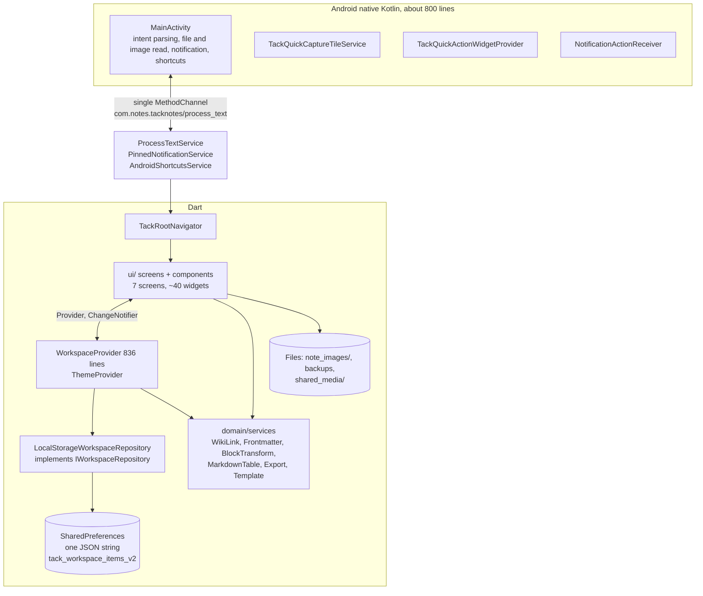
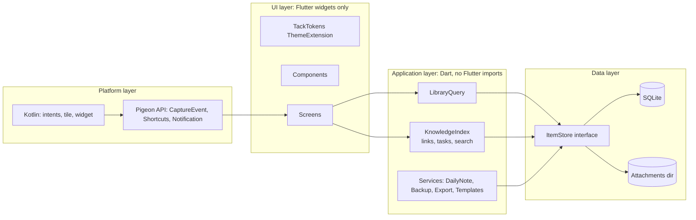

# 08 — Technical Architecture Review

> Assessment of the existing Flutter + Kotlin architecture and recommendations for the redesign. **No code was changed.**
> Evidence labels: **[Verified]** read by me · **[Reported]** from a sub-agent file:line report · **[Inferred]** reasoned, not profiled · **[Background]** general platform knowledge, to be re-checked. **No profiling was run**; every performance statement is a hypothesis until measured (§9).

---

## 1. Current architecture

Libraries [Verified, `pubspec.yaml`]: `provider`, `shared_preferences`, `google_fonts`, `lucide_icons_flutter`, `flutter_svg`, `image_picker`, `path_provider`, `share_plus`, `pdf`, `printing`, `image`, `vector_math`, `url_launcher`. **No database, no state-management library beyond Provider, no file picker, no crypto, no analytics.**

---

## 2. Findings by area

### 2.1 State management — **adequate; split, don't replace**
- `WorkspaceProvider` (836 lines, `ChangeNotifier`) holds: master list, trash/archive/favourite lists, id index, category, search, sort, folders, tags cache, daily-note creation, import/export, quick-item creation, breadcrumb logic. [Verified outline]
- `loadItems()` **replaces the master list with the currently filtered list** (category or search). This one design choice is the root cause of the backup-omission and Today's-Note bugs (`03`, §7). View state and data are conflated. [Verified `workspace_provider.dart:116-126`]
- `saveItem` re-sorts everything, `notifyListeners()`s, then writes the whole store, then re-syncs Android shortcuts, on **every autosave**. [Verified `:303-327`]
- Screens `context.watch<WorkspaceProvider>()`, so any save rebuilds every watcher, including the editor and spec cards on the board. [Reported]
- **Recommendation:** keep Provider (no evidence it is the problem). Split into: **`ItemStore`** (all items, never filtered), **`LibraryQuery`** (category, folder, tag, sort, search; produces a derived view), **`KnowledgeIndex`** (links, backlinks, tasks, search index; updated incrementally per save), **`DailyNoteService`**, **`BackupService`**. Use `context.select`/`Selector` so a save of note A does not rebuild screens that show note B.

### 2.2 Data model — **sound hierarchy, wrong boundaries**
- The OOP hierarchy is clear and tested for serialisation. [Verified]
- `WhiteboardCanvasItem` imports Flutter's `Offset` for `panOffset`, so the **domain layer depends on `dart:ui`**. [Verified `whiteboard_item.dart`: `panOffset = Offset.zero`] Services under `lib/domain/services/` that wrap `MethodChannel` (`ProcessTextService`, `PinnedNotificationService`, `AndroidShortcutsService`) are **platform adapters living in the domain layer**. [Verified]
- `IStorageDriver` is documented as a pillar and never used. [Verified]
- Board images and note images are referenced by **absolute file paths** in item data; these break if the app directory changes (restore, reinstall, or Android scoped-storage moves). [Reported]
- Links are title strings; no stable link ids. [Verified by grep]
- No schema version on items (only on the backup envelope `version: 2`). [Reported/Verified]
- **Recommendation:** move platform adapters to `data/` or `platform/`; store board viewport and images relative to a managed attachments directory with stable ids; add `schemaVersion`; introduce link ids (decision in §5).

### 2.3 Storage — **the most important technical risk**
- One JSON string in `SharedPreferences`, rewritten whole per save, loaded whole at start. [Verified]
- On Android the legacy `SharedPreferences` API persists to an XML file and is held in memory [Background]; no documented hard size cap, but large single values are a known anti-pattern for startup time and atomicity. [Background]
- Failure handling: a thrown decode seeds example data in memory, and the next save overwrites the unreadable blob without keeping a copy; individual items that fail to deserialise are dropped silently and permanently on next save. [Verified code, `workspace_repo_impl.dart:47-88`]
- `AndroidManifest.xml` does not set `android:allowBackup`, so the default (`true`) applies and Auto Backup may copy app data off-device. This may be desirable or a privacy surprise for a "private, local" product. [Verified absence; behaviour Background]
- Whiteboard saves occur on every gesture end (30 call sites) and on open and dispose (which also bump `updatedAt`). [Reported]

| Option | Pros | Cons | Verdict |
|---|---|---|---|
| **A. Keep prefs, add safeguards** (keep last-good copy, atomic write, debounce) | Zero migration | Still O(workspace) per save; no incremental search | Stopgap only |
| **B. SQLite as live store** (e.g. `drift` or `sqflite`; FTS5 for search) | Transactional, incremental writes, indexes, search, scales to 10k+ items | Migration, dependency, FTS5 availability must be confirmed (bundled SQLite via `sqlite3_flutter_libs` is the usual route [Background]) | **Recommended** |
| **C. Markdown/`.canvas` files as source of truth** (Obsidian-style) | Maximum openness; user can sync with any tool | Android scoped storage / SAF complexity, slow directory scans, concurrency and rename semantics, harder search | Only if the product owner wants "vault" as a feature (Decision D3) |
| **D. Hybrid: SQLite live + Markdown/JSON Canvas export/import** | Safe, fast, still open | Two representations to keep consistent | **Recommended path** (matches F7) |

**DECISION D3:** does Tack promise "your files" (C) or "your data, exportable" (D)? Recommend **D** for the redesign scope.

### 2.4 Widget organisation — **four god widgets**
| File | Lines | Problem |
|---|---|---|
| `whiteboard_canvas_screen.dart` | 5,139 | One ~4,700-line `State` with 26 fields; rendering, geometry, auto-layout algorithm, export, persistence, dialogs, four painters, 71 `setState`; 13 linear `firstWhere` lookups by id [Reported] |
| `note_editor_screen.dart` | 2,731 | Editing, reading, find/replace, tags, sub-notes, export, backlinks in one class; `build` recomputes counts, triggers, headings and backlinks per keystroke [Reported] |
| `rich_note_content_view.dart` | 2,032 | Custom line-regex Markdown renderer, rebuilds entire column on any change, no lazy list, no cross-line selection [Reported] |
| `mermaid_diagram_card.dart` + parser + completion + template sheet | ≈3,200 | A bespoke diagram engine; pan/zoom dead behind `IgnorePointer` [Reported] |

**Recommendation (extraction order):**
1. **Board:** `BoardController` (state, undo ring, id-indexed `Map<String, CanvasNode>`), `BoardGestures`, `BoardPainters` (grid cached as a `Picture`, edges with indexed lookups, `shouldRepaint` on revision counters), `BoardLayoutService` (auto-arrange as a pure function, unit-tested), `BoardExporter` (size-capped, off the UI isolate where possible), node widgets. Replace whole-screen `setState` during drag with a `ValueNotifier`/`ChangeNotifier` per interaction layer.
2. **Reader:** parse once into a block model (headings, paragraphs, lists, tasks, tables, code, embeds), cache by content hash, render with a lazy list.
3. **Editor:** extract `EditorController` and per-feature panels (find, tags, sub-notes, export).
4. **Mermaid:** freeze scope; decide per `03` #13.

### 2.5 Reusable components — **partially consolidated**
- `AppBottomSheet`, `AppSearchField` exist and have tests. [Verified]
- Still duplicated: three feedback components; two card families; raw `showModalBottomSheet` calls; `GestureDetector` chips. [Reported]
- 344 hard-coded colours and 279 inline text styles bypass tokens. [Reported]
- **Recommendation:** one `TackTokens` `ThemeExtension`, an `ink`/`surface` helper on `BuildContext`, and an `analysis_options` custom lint or CI grep forbidding `Color(0x` and `TextStyle(` under `lib/ui/`.

### 2.6 Theme management — **fine**
`ThemeProvider` persists the mode; the system-bar overlay now follows brightness. [Verified] Gaps: default is Light not System; `google_fonts` fetch-at-runtime; tokens duplicated outside the token layer.

### 2.7 Assets — **needs bundling**
`pubspec.yaml` bundles `icon.png` and `icons/` (18 SVG). No fonts. [Verified] **Bundle DM Sans, the reading serif, and JetBrains Mono** and set `GoogleFonts.config.allowRuntimeFetching = false` [Background: the package exposes this flag; confirm for the pinned version]. This also removes a likely test flake. [Inferred]

### 2.8 Native Android integration — **capable, but a thin ad-hoc protocol**
- One `MethodChannel` with string method names and untyped `Map` payloads (`action`, `text`, `title`, `fileName`, `imagePath`, `sourceApp`, `packageName`). [Verified]
- **File and image reads run synchronously on the main thread** inside `handleIntent` (called from `onCreate`/`onNewIntent`): `readText()` is unbounded and `saveImageToInternal` copies a stream. Large shared files risk an ANR. [Verified `MainActivity.kt:343-351, 398-417`]
- **Shared images are saved to `filesDir/shared_media`** by Kotlin, but the Dart orphan sweeper scans `getTemporaryDirectory()/shared_media` (the cache dir), a different folder, and only note text is scanned for references. Net: shared images are likely never cleaned. [Verified paths; consequence Inferred]
- `tack://action/...` is an exported VIEW deep link; any app or web page can trigger note/board creation. Low severity, but it should require an explicit confirm or be limited to launcher/widget sources. [Verified manifest]
- The persistent quick-capture notification has native code but **no way to enable it from Dart**. [Verified]
- Release build is **signed with the debug key** (`// TODO` in `build.gradle.kts`). [Verified] Must change before any distribution.
- **Recommendation:** replace the ad-hoc channel with **Pigeon** (generated, typed Dart↔Kotlin interface) [Background]; move file/image IO to a background thread (`Dispatchers.IO` or an executor) with a size cap; define a single `CaptureEvent` type; add a release signing config.

### 2.9 Performance — hypotheses to measure
| Area | Mechanism | Evidence |
|---|---|---|
| Typing latency | Per keystroke: regex over full text, backlinks over all notes, heading extraction compiling `RegExp` per line, Mermaid-fence regexes, `buildTextSpan` with a 13-alternative regex and repeated `GoogleFonts.jetBrainsMono` calls | [Reported] |
| Autosave cost | Whole-store JSON encode + prefs write + re-sort + notify + shortcuts sync | [Verified] |
| Home grid | All cards built eagerly with per-card rotation | [Reported] |
| Graph | 70 × N²/2 pair operations synchronously in `build`; signature string of all items per build | [Reported] |
| Board drag | `setState` per pan update rebuilds all nodes; edges painter `shouldRepaint` always true, O(E·N) lookups; grid builds ~46k points per paint | [Reported] |
| Board export | Output up to ~18,000 px per side at 3× | [Reported] |
| Search | Not debounced; filters whole list; no body index | [Reported] |
| Image decode | `Image.file` without `cacheWidth` | [Reported] |

### 2.10 Testing
Two test files (`phase1_services_test.dart`, `phase2_ui_audit_test.dart`) cover services, serialisation, a few components and the editor back flow. No coverage for Home, Settings, backup/restore, repository, search/filter, or the board. [Reported] Tests that pump `GoogleFonts` may attempt network fetches. [Inferred]

---

## 3. Separation of concerns for the redesign

Rules: UI imports app layer, never data/platform directly; app layer has no `package:flutter` imports (so it can be tested headless, and potentially shared with a Rust or desktop build later); models use their own `Point`/`Vec` types instead of `Offset`.

---

## 4. Should Rust be used? — evidence-based answer

**Short answer: not now, and not on current evidence.**

### 4.1 What Rust could plausibly do
Candidate CPU-bound workloads that exist in Tack: Markdown block parsing/indexing, wiki-link and backlink extraction, full-text search index, graph layout, board auto-layout and edge routing, board hit-testing, export rasterisation.

### 4.2 Why it is premature
1. **Every identified hot spot is algorithmic or architectural before it is a language problem.** Per-keystroke whole-workspace scans, whole-store rewrites, O(N²) layout on the UI isolate, `shouldRepaint => true`, linear id lookups. These are fixed by incremental indexing, caching, SQLite/FTS, id maps and `Isolate.run`, with no new toolchain.
2. **No measurement exists.** There is no benchmark showing Dart cannot meet a frame budget on a representative vault.
3. **Cost to a solo developer:** Rust toolchain, `cargo-ndk`, per-ABI native libraries (APK size), a bridge (`flutter_rust_bridge` or `uniffi`), marshalling costs for large strings, debugging across FFI, CI. [Background]
4. **Flutter ↔ Rust boundary overhead** can erase gains for small, frequent calls like per-keystroke work.

### 4.3 Where Rust *might* earn a place later (gated)
Only if, after §2 fixes, measured results still miss budgets:

| Candidate | Trigger | Libraries one would evaluate [Background] |
|---|---|---|
| Search/index core | p95 query > 100 ms at 5,000 notes with SQLite FTS | `tantivy` |
| Markdown parse + link/task extraction | Parse+index > 8 ms for a 50 KB note in Dart after caching | `pulldown-cmark` |
| Graph layout for 2,000+ nodes | > 200 ms off-isolate | `fdg`/custom |
| Shared core for a future desktop/web build | Product decision to ship desktop | Rust crate behind a stable API |

**Process gate:** build a benchmark harness (§9), publish numbers, and only open a Rust spike if a named budget is missed after the cheap fixes.

---

## 5. Link identity decision (feeds `04` F5)

| Option | Disk format | Resolution | Rename | Trade-off |
|---|---|---|---|---|
| **L1 (recommended)** | Markdown keeps `[[Title]]`; DB keeps a link table `(source_id, target_id, anchor)`; titles on rename are rewritten in all sources in one transaction | By id after first parse | Atomic rewrite of `[[Old]]` → `[[New]]` | Exported Markdown stays human-readable; rename touches multiple rows |
| L2 | `[[id\|Title]]` in the body | By id | No rewrite | Ugly Markdown; not Obsidian-compatible |
| L3 | Aliases table only | By alias | Keep old titles as aliases | Never loses a link; duplicates titles remain ambiguous |

Use L1 + L3 (keep the previous title as an alias) as a safety net.

---

## 6. Open-format export mapping (feeds `04` F7)

| Tack | Export | Fidelity |
|---|---|---|
| Note | `Notes/<title>.md` with YAML frontmatter intact | High (fix title/frontmatter ordering bug first) |
| Board | `Boards/<title>.canvas` (JSON Canvas) | JSON Canvas defines text, file, link and group nodes and edges [Verified: jsoncanvas.org overview]; Tack's typed shapes (decision, I/O, start/end) need either an extension field or flattening to text nodes with a style hint. **Check the spec before committing.** |
| Images | `Attachments/…` with relative paths in Markdown | High |
| Inbox flag | `inbox: true` frontmatter | High |

---

## 7. Android specifics to carry into the redesign

- Android 13+ notification permission is requested via `POST_NOTIFICATIONS` already declared [Verified]; request it only when the user enables the notification feature.
- Predictive back: `android:enableOnBackInvokedCallback="true"` is set [Verified]; keep `PopScope` logic mode-aware (done in editor).
- Edge-to-edge handled; verify bottom bar inset and keyboard behaviour in each sheet.
- Widget: RemoteViews are limited; design the new widget for what RemoteViews can do (text, simple lists via `RemoteViewsService`).
- `android:launchMode="singleTop"` and `taskAffinity=""` are set [Verified]; verify share-while-running behaviour (`onNewIntent`) after changing capture to "no editor opened".

---

## 8. Ordered recommendations

| # | Action | Type | Effort | Unblocks |
|---|---|---|---|---|
| 1 | Separate `ItemStore` (unfiltered) from view state; fix backup and Today's Note | Fix | S | M1 |
| 2 | Atomic write + keep last-good copy + never overwrite unreadable store | Fix | S | M1 |
| 3 | Bundle fonts; disable runtime fetch | Fix | S | Offline promise, tests |
| 4 | Move file/image IO off the main thread; cap sizes | Fix | S | Share reliability |
| 5 | Release signing config | Fix | S | Distribution |
| 6 | Introduce SQLite store + migration from the JSON blob; FTS | Build | M–L | M3, F4, F5 |
| 7 | Link table + rename propagation | Build | M | M2 |
| 8 | Token `ThemeExtension` + lint; replace hard-coded colours/styles | Refactor | M | Redesign |
| 9 | Board refactor per §2.4 + debounce save + id maps + culling | Refactor | L | M9 |
| 10 | Reader block model + lazy list; editor derived-data caching | Refactor | M | Typing latency |
| 11 | Pigeon-typed native API | Refactor | S–M | Capture redesign |
| 12 | Benchmarks and budgets (§9) | Process | S | Evidence for or against Rust |

**Not recommended:** a full rewrite; swapping Provider for another library; adopting Rust now; adding cloud sync.

---

## 9. Performance budgets and benchmark plan

Create a synthetic dataset generator (not a mock UI): 200 / 1,000 / 5,000 notes (avg 2 KB, 5 % over 50 KB, 10 % with tasks, ~3 links each) and boards of 20 / 100 / 400 nodes.

| Metric | Budget (proposal) | Tool |
|---|---|---|
| Cold start to first Library frame (1,000 notes) | < 800 ms on a mid-range Android | `flutter run --profile`, startup trace |
| Keystroke to frame (50 KB note) | < 16 ms p95 | DevTools timeline |
| Autosave cost (1,000 notes) | < 20 ms and no jank | Timeline |
| Search (5,000 notes) | < 100 ms p95 | Unit benchmark |
| Board drag (400 nodes) | ≥ 55 fps | Timeline |
| Board export (400 nodes, 2×) | < 3 s and < 250 MB peak | Memory profiler |
| Graph layout (2,000 nodes) | < 300 ms off UI isolate | Benchmark |
| Backup of 5,000 notes | < 2 s, count matches library | Unit test |

Budgets are my proposals [Hypothesis]; adjust after measuring on the developer's actual device.
