# 09 — Redesign Roadmap

> Implementation-independent plan for the Figma redesign, prototyping, validation and hand-off to development.
> It starts **after** the analysis in documents 01–08 and the decisions in §1 below. Durations are **estimates for a single designer-developer working part-time** and exist only to show relative size [Hypothesis].

---

## 0. What has been completed

| Done | Document |
|---|---|
| Product understanding, evidence of what Tack is | `01` |
| Competitor study with verified vs hypothesised claims | `02` |
| Full UI audit and per-feature verdicts | `03` |
| Feature strategy and MVP | `04` |
| Information architecture and flows | `05` |
| Three visual directions | `06` |
| Design system proposal (Direction A tokens) | `07` |
| Technical review and Rust assessment | `08` |

**Not done, deliberately:** no Figma file, no code, no mock implementation, no dependency or configuration change.

---

## 1. Decisions required before Figma starts (Phase 0)

| ID | Decision | Options | Recommended default | Blocks |
|---|---|---|---|---|
| D1 | One organising model | A: links + tags + 1-level folders · B: links + tags + sub-note tree · C: keep all | **A** (needs usage check of `parentId`/folders) | Library filters, note header, move flow |
| D2 | Empty new draft on Back | keep / discard / ask | **Discard untouched empty draft** | Capture and editor flows |
| D3 | Data promise | "your files" vs "your data, exportable" | **Exportable** (SQLite live + Markdown/JSON Canvas export) | Settings, backup flow, `08` roadmap |
| D4 | Revise `AGENTS.md` locked decisions? | Keep as-is · amend specific items | **Amend** so that desktop list view (if drawn), typography/tracking, palette names and icon-library statements match reality | Desktop frames, token freeze |
| D5 | Visual direction | A / B / C / hybrid | **A with B's press response and C's dark/board logic** | All visual work |
| D6 | Retire Sticky and Clipboard as types | Retire / keep Sticky / keep both | **Retire; migrate** | Create flow, cards, data migration |
| D7 | Desktop and tablet | Not in v1 / explore only / ship | **Explore only in Figma** | Layout system depth |
| D8 | Archive | Complete it / remove it | **Remove** (Trash + Pin) | Drawer/You sheet |
| D9 | Mermaid scope | Keep all / flowchart + convert only / drop | **Flowchart + convert-to-board; freeze rest** | Editor insert menu, components |
| D10 | Android Auto Backup | Allow / disable | **Decide explicitly** (manifest currently default-allow) | Privacy copy, onboarding |

Exit criterion: each decision has an owner-recorded answer in a one-line decision log in `docs/design/10-design.md` §12.

---

## 2. Phase plan

```mermaid
gantt
  dateFormat  X
  axisFormat  %s
  title Redesign phases (relative size, not calendar commitments)
  section Foundation (no visual dependency)
  Baselines and benchmarks         :a1, 0, 1
  Data safety and storage fixes     :a2, 0, 4
  section Design
  Phase 0 Decisions                :d0, 0, 1
  Phase 1 Research and baselines   :d1, 1, 2
  Phase 2 Foundations in Figma     :d2, 2, 4
  Phase 3 Direction trial          :d3, 3, 4
  Phase 4 Core flows hi-fi         :d4, 4, 8
  Phase 5 Prototype and test       :d5, 8, 10
  Phase 6 System and hand-off      :d6, 10, 12
  section Build
  Token layer and components       :b1, 10, 14
  Screens by flow                  :b2, 12, 20
```



### Parallel track — foundation fixes (can start now, independent of visuals)
Reliability items from `08` §8 (#1–#5, #11, #12): unfiltered store and backup, atomic writes with last-good copy, bundled fonts, off-main-thread file IO, release signing, benchmark harness. They remove P0 risks and are required before any redesigned screen is trustworthy.

---

## Phase 1 — Research and baselines (≈ 1–2 weeks)

| Activity | Output | Method |
|---|---|---|
| Usage evidence | Counts of items by type, folders, `parentId`, tags, tasks, boards, average note size | Read-only script over exported backups of 5–10 real users (including the developer), with consent |
| Interviews | 5–8 sessions, 30 min | Context + behaviour questions from the UX skill: "Walk me through the last thing you saved from your phone", "Show me how you find an old note", "What do you do with a flowchart after you draw it?" |
| Task baseline on the *current* app | Success/time/error on 5 tasks | Tasks: capture from browser; find a note by a word in its body; link two notes; build a 10-node flow; back up and restore |
| Accessibility baseline | List of failures | TalkBack walk-through of Home → Note → Board; 200 % text; touch-target audit |
| Persona refinement | Replace hypotheses A/B with evidence-backed personas, or retire them | Needs ≥ 20 users for "high" confidence; below that label as exploratory |

Exit: a **baseline table** (task, success rate, time, errors, satisfaction) to compare against after redesign.

---

## Phase 2 — Foundations in Figma (≈ 2 weeks)

1. **File structure**
   ```
   Tack Design System   (library file, published)
   ├── 00 Cover and changelog
   ├── 01 Foundations   (colour, type, space, radius, elevation, iconography, motion)
   ├── 02 Components    (all states, light/dark, 100/130/200 % text)
   ├── 03 Patterns      (capture, triage, search, selection, sheets, empty/error)
   └── 04 Playground
   Tack Product         (consumes the library)
   ├── 10 Flows, 20 Screens, 30 Prototypes, 40 Research, 90 Archive
   ```
2. **Variables** per `07` §9: Primitives → Semantic (Light/Dark modes) → Type → Component → Scale modes.
3. **Component set** by priority: button, icon button, chip, text/search field, note card, board card, app bar (3 variants), bottom bar, bottom sheet, menu, toast, empty state, task row, property pill, editor toolbar.
4. **Accessibility annotations** in Figma: hit area overlay, Semantics label field, contrast check plugin pass.
5. Define the **component acceptance checklist** from `07` §10.

Exit: foundations reviewed; every component shows states and 200 % text.

---

## Phase 3 — Direction trial (≈ 1 week, overlaps Phase 2)

Build the same three screens in each direction (A/B/C): Library (mobile), Note Read, Board with 12 nodes. Test with 5 people (`06` closing section). Outcome: D5 confirmed. Do not continue to full flows before this is answered.

---

## Phase 4 — Core flows, high fidelity (≈ 4 weeks)

### 4.1 Screen and state inventory

| Area | Screens/states to design |
|---|---|
| **Today** | first run · typical day · Inbox badge · empty tasks · all clear (mascot) |
| **Library** | grid (2/3/4 columns) · filtered · empty · loading skeleton · selection mode (post-MVP) · long-press peek |
| **Search** | empty (recents) · typing · results groups · no results · actions |
| **Capture** | sheet default · keyboard open · saved toast · from share (no UI) · error |
| **Inbox triage** | card stack · after action · Inbox zero |
| **Note Read** | short · long with headings · table · task list · code · Mermaid flowchart · embed of a board · backlinks collapsed/expanded · long title · RTL/long words |
| **Note Edit** | toolbar · insertion menu · wiki-link autocomplete · find bar · properties sheet · keyboard states |
| **Boards** | gallery with thumbnails · empty |
| **Board canvas** | empty · 12 nodes · node selected · connector selected · multi-select · connect mode · spec-card pin sheet · export sheet · minimap · 200 % text |
| **System** | Trash · You sheet · Settings · Backup (success, partial, error) · Restore preview · About |
| **Android surfaces** | Quick Settings tile · widget (2 sizes) · share confirmation toast · launcher shortcuts |
| **First run** | at most 3 screens: promise (local, private), capture methods, optional import |
| **Themes** | Light, Dark; 130 % and 200 % text; one tablet frame; one desktop frame (explore) |

### 4.2 Flows to prototype (from `05` §7)
Capture-from-share, start-the-day, write-and-link, spec-to-board, find, triage, backup/restore.

### 4.3 Design reviews
- **Heuristic review** against `07` principles after each flow.
- **Locked-decision check** each review: grid-only notes (until D4), no redundant control, Home→Read→Edit, tokens only.
- **Accessibility check**: contrast ≥ 4.5 : 1, hit ≥ 48 dp, text-scale 200 %.

---

## Phase 5 — Prototype and validation (≈ 2 weeks)

### Study design (from the UX skill's usability workflow)
- **Method:** moderated remote or in-person, 5–8 participants per round, 45 min; unmoderated option 10+ for the capture/triage task only.
- **Tasks (scenarios, not instructions):**
  1. "You are reading an article on your phone and want to keep a line from it for later." *(Capture)*
  2. "You remember writing something about onboarding last week but not the title." *(Search)*
  3. "You have a spec; show how the steps relate." *(Spec → board)*
  4. "Check what you still have to do today." *(Today and tasks)*
  5. "Move a draft you captured into a project." *(Triage + organise)*
  6. "Make sure nothing is lost if you change phones." *(Backup/restore)*
- **Metrics and targets** (from the skill's defaults, to be adjusted): completion > 80 %, time ≤ 2× expected, error < 15 %, satisfaction > 4/5. Record severity per issue: 4 critical, 3 major, 2 minor, 1 cosmetic.
- **Comparisons:** same tasks on the current app baseline (Phase 1).
- **Specific hypotheses to test:** Today-first navigation; Inbox without opening the editor; Library vs Boards separation; peek-before-open; "Do anything" sheet discoverability; board selection bar placement.

Exit: all severity-4 and severity-3 findings resolved or consciously deferred in writing.

---

## Phase 6 — System finalisation and developer hand-off (≈ 2 weeks)

| Deliverable | Detail |
|---|---|
| Published library | Tokens, components, patterns |
| Token export | JSON of variables for Dart, mapped using the table in `07` §9 |
| Redlines only where needed | Spacing from variables; no screen-by-screen red-lining |
| Interaction spec | Back behaviour, gestures, keyboard, haptics, motion (durations from tokens) |
| Content spec | Strings, empty-state copy, error copy, toasts |
| Accessibility spec | Semantics labels per component, focus order, 200 % behaviour |
| Migration spec | Sticky→Note, Clipboard→Inbox, `terracotta→peach`, `yellow→amber`, old links→id-backed, old `favourite/archive`→`pinned` |
| Backlog | Epics mapped to the MVP list in `04` §3 with acceptance criteria |

---

## 3. Development sequencing after hand-off (guidance, not a design deliverable)

1. Tokens and `ThemeExtension`; lint to forbid hard-coded colours/styles.
2. Shared components (those in the Phase 2 priority list).
3. Storage and index (SQLite, link table) behind the existing repository interface, with a **migration tested on real exports**.
4. Screens by flow in this order: **Capture → Inbox → Today → Library → Search → Note Read/Edit → Boards → Settings/Backup**. Board refactor (`08` §2.4) precedes any new board features.
5. Android surfaces (tile, widget, shortcuts) last, because they depend on Capture.
6. Remove superseded code only after the replacement ships (Archive, list-card remnants, `IStorageDriver`, stale release-note copy).

---

## 4. Success criteria (measurable)

| Criterion | Target |
|---|---|
| Capture from another app | ≤ 2 taps, editor not opened |
| Time to first meaningful action at launch | ≤ 2 taps |
| Search finds a word that only appears in a note body | 100 % of test cases |
| Backup count equals library count including Trash | 100 % |
| Renaming a note keeps inbound links | 100 % |
| Accessibility | 0 targets < 48 dp in shipped screens; Semantics on all interactive elements; 200 % text without clipping |
| Token compliance | 0 hard-coded `Color(0x…)` / inline `TextStyle(` in `lib/ui/` |
| Typing latency (50 KB note) | < 16 ms p95 |
| Usability | Phase 5 metrics met on ≥ 5 of 6 tasks |

---

## 5. Risk register

| Risk | Likelihood | Impact | Mitigation |
|---|---|---|---|
| Redesign proceeds before data-safety fixes | Medium | **Severe** (data loss under a prettier UI) | Run foundation track in parallel and gate release on it |
| Migration corrupts existing data | Low–Med | Severe | Keep last-good copy; run migration against real exports; dry-run mode |
| Scope creep from "universal workspace" ideas | High | High | Feature gate in `04` §1; rejected list |
| One-person bandwidth | High | High | Ship in vertical slices; MVP list is the cut line |
| Direction A resembles Notion's mood | Medium | Medium | Differentiate through Pin Red, pin motif, board; avoid its layouts |
| Board refactor regressions (no tests today) | High | High | Write characterisation tests for layout, serialisation, export before refactor |
| Locked decisions block good solutions | Medium | Medium | Resolve D4 up front |
| Fonts bundling increases APK | Low | Low | Subset to Latin + needed glyphs |
| Misreading `DESIGN.md` as an app spec | Medium | Medium | `02` §5 caveat; tokens are Tack's own |

---

## 6. Sign-off checklist for ending the analysis phase

- [ ] Product owner has read `01`, `03`, `04` and answered D1–D10.
- [ ] `AGENTS.md` / `README.md` / `AUDIT.md` drift acknowledged (update after decisions, not before).
- [ ] Direction trial scheduled.
- [ ] Foundation fixes scheduled in parallel.
- [ ] Usage data request sent to 5–10 volunteers.
