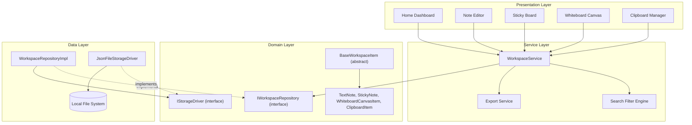
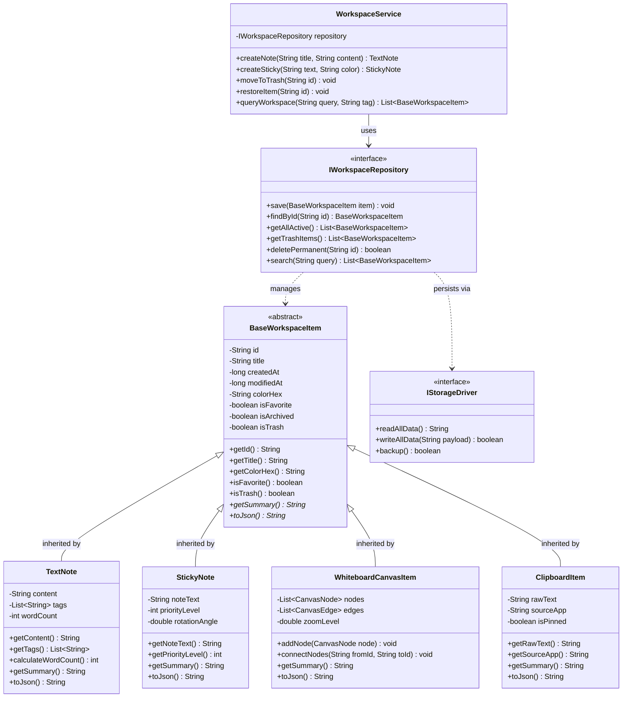
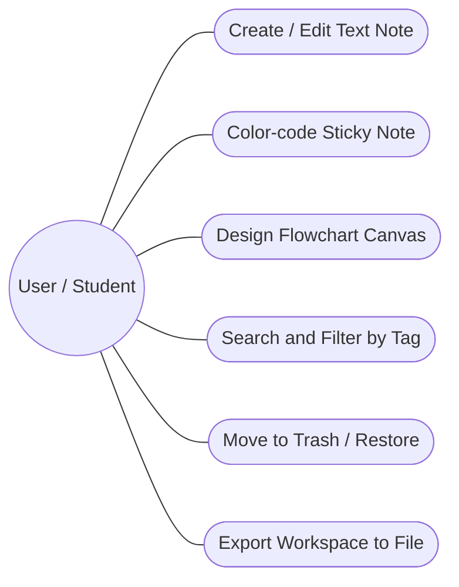
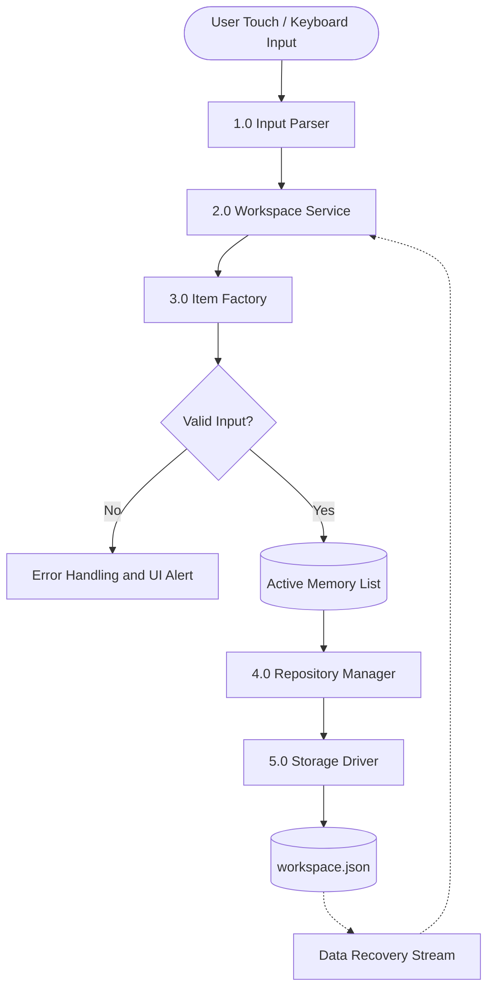

# Java Micro Project Presentation (PPT)

---

## Slide 1: Title Slide

```
================================================================================
                                JAVA MICRO PROJECT
                                    ON
            TACK: SMART NOTE-TAKING & WORKSPACE MANAGEMENT SYSTEM
================================================================================
```

* **Project Title:** Tack – Tactile Note-Taking, Sticky Notes & Whiteboard Workspace System
* **Domain:** Core Java & Object-Oriented Software Engineering (OOPS)
* **Academic Level:** Diploma / Undergraduate Engineering Micro Project
* **Prepared By:**
  * Student Name: [Student Name / Roll No.]
  * Branch / Semester: Computer Engineering / Semester IV/V
  * Academic Year: 2025 – 2026
* **Project Guide:** [Prof. Guide Name]
* **Department:** Department of Computer Engineering

---

## Slide 2: Introduction

* Note-taking and workspace productivity tools are central to academic, engineering, and professional workflows.
* Traditional desktop applications often suffer from clutter, high memory footprints, and rigid separation between plain notes, sticky scratchpads, and visual brainstorming flowcharts.
* **Tack** is an object-oriented, tactile workspace productivity suite engineered to consolidate:
  * **Text Notes** with categorization, word counting, and tag filtering.
  * **Sticky Notes** with color-coded priority grouping and quick recall.
  * **Whiteboard Flowchart Nodes** supporting node creation, geometric connectors, and coordinate persistence.
  * **Clipboard Snippet Management** for caching frequently copied text snippets.
* Built from the ground up demonstrating strict **Object-Oriented Programming (OOP)** paradigms in Java: Abstraction, Encapsulation, Polymorphism, Interface-driven Repository Architecture, and Factory design patterns.

---

## Slide 3: Problem Statement

* **Fragmented Tools:** Users must switch between separate tools for quick sticky notes, long-form structured notes, and flowchart brainstorming.
* **Inflexible Domain Models:** Many existing note systems use monolithic text files without structured domain hierarchies, making multi-type item processing brittle.
* **Poor Organization & Search:** Lack of unified polymorphic querying (filtering across notes, stickies, whiteboards, trash, and archives simultaneously).
* **Heavyweight Resource Footprints:** Bloated enterprise suites consume hundreds of megabytes of RAM just for basic scratchpad tasks.
* **Absence of Clean Offline Persistence:** Difficulty operating locally without enforced cloud logins and latency.

---

## Slide 4: Objectives

1. **Apply Core OOP Principles:** Design an extensible Java domain model utilizing abstract classes, interfaces, inheritance, and dynamic polymorphism.
2. **Unified Workspace Engine:** Enable management of diverse item types (`TextNote`, `StickyNote`, `WhiteboardCanvasItem`, `ClipboardItem`) under a single polymorphic contract (`BaseWorkspaceItem`).
3. **Repository & Storage Decoupling:** Implement the Repository and Strategy patterns (`IWorkspaceRepository`, `IStorageDriver`) to abstract data persistence (JSON / File I/O / In-Memory).
4. **Rich Search & Tag Filtering:** Provide sub-millisecond search across titles, content, tags, pinned status, and favorites.
5. **Interactive Lifecycle Management:** Support full CRUD, Soft Delete (Trash & Restore), and Archival workflows.
6. **Diagrammatic Brainstorming Support:** Model visual canvas nodes (Start/End, Process, Decision, I/O) and directional edges.

---

## Slide 5: Proposed System

* **Polymorphic Architecture:** All workspace artifacts inherit from an abstract base class `BaseWorkspaceItem`, enabling uniform collection processing.
* **Multi-Format Workspace:**
  * **Text Notes:** Full markdown/rich text model with word/character statistics and tag indexing.
  * **Sticky Notes:** Pastel color palette assignments, priority pins, and spatial rotations.
  * **Whiteboard Flowchart System:** Directed node-edge graph modeling with automated serialization.
  * **Clipboard Stack:** Temporal snippet buffer with one-click copy and pin mechanisms.
* **Tiered Storage Pipeline:** Decoupled persistence driver that serializes domain objects into human-readable JSON files with fault-tolerant recovery.
* **Defensive Programming:** Immutability-first data records with pure `copyWith()` mutators to ensure zero accidental state contamination.

---

## Slide 6: Technologies Used

| Category | Technology / Tool | Version / Spec | Purpose |
| :--- | :--- | :--- | :--- |
| **Primary Language** | Java (JDK) | 17 / 21 LTS | Core business logic, domain models, OOP implementation |
| **Architecture** | Layered / Repository Pattern | Clean Architecture | Separation of UI, Service, Domain, and Data layers |
| **Persistence** | JSON / Java File I/O (`java.nio`, `Gson` / `Jackson`) | 2.10+ | File-based offline serialization and deserialization |
| **Collection Framework** | Java Collections Framework | Standard | `List`, `Map`, `Set`, `Collectors`, `Streams` API |
| **GUI / Presentation** | Java Swing / JavaFX / Mobile Flutter Bridge | Modern UI Tokens | Tactile UI components, cards, pastels, and toolbars |
| **Build & Testing** | Maven / Gradle / JUnit 5 | 5.10+ | Dependency management and automated unit tests |
| **IDE / Version Control** | IntelliJ IDEA / VS Code / Git | Latest | Version control, profiling, and static code analysis |

---

## Slide 7: System Design & Architecture Diagrams

### 7.1 System High-Level Layered Architecture



---

### 7.2 UML Class Diagram (Demonstrating Java OOP Principles)



---

### 7.3 Use Case Diagram



---

### 7.4 Data Flow Diagram (DFD Level-1)



---

## Slide 8: Modules Description

1. **Domain Model Module (`domain.models`):**
   * Encapsulates data integrity via immutable fields, getters, and pure transformation methods.
   * Defines standard behavior for notes, stickies, canvases, and clipboard snippets.
2. **Repository & Abstraction Module (`domain.interfaces`):**
   * Declares strict contracts for item retrieval, filtering, pagination, and persistent storage drivers.
3. **Workspace Service Coordinator (`domain.services`):**
   * Acts as the business brain, coordinating CRUD workflows, validation, and multi-criteria search.
4. **Data Persistence Module (`data.repositories` & `data.drivers`):**
   * Converts in-memory object graphs to serialized JSON; handles atomic file writing and backup recovery.
5. **Flowchart & Graph Engine Module (`domain.whiteboard`):**
   * Manages nodes (coordinates $x, y$, shapes, labels) and directional edges with auto-snapping logic.
6. **User Interface Module (`ui.components` & `ui.screens`):**
   * Provides responsive cards (`StickyNoteCard`, `SmartNoteListCard`, `ClipboardCard`) and toolbars.

---

## Slide 9: Implementation Details (Core Java Code)

### 9.1 Polymorphic Base Class (`BaseWorkspaceItem.java`)

```java
package com.tack.domain.models;

import java.util.UUID;

public abstract class BaseWorkspaceItem {
    private final String id;
    private final String title;
    private final long createdAt;
    private final String colorHex;
    private boolean isFavorite;
    private boolean isTrash;

    public BaseWorkspaceItem(String title, String colorHex) {
        this.id = UUID.randomUUID().toString();
        this.title = title != null ? title.trim() : "Untitled";
        this.colorHex = colorHex != null ? colorHex : "#F8F9FA";
        this.createdAt = System.currentTimeMillis();
        this.isFavorite = false;
        this.isTrash = false;
    }

    public String getId() { return id; }
    public String getTitle() { return title; }
    public String getColorHex() { return colorHex; }
    public boolean isFavorite() { return isFavorite; }
    public boolean isTrash() { return isTrash; }

    public void setFavorite(boolean favorite) { this.isFavorite = favorite; }
    public void setTrash(boolean trash) { this.isTrash = trash; }

    // Polymorphic abstract methods overridden by all subclasses
    public abstract String getSummary();
    public abstract String toJson();
}
```

### 9.2 Specialized Subclass (`TextNote.java`)

```java
package com.tack.domain.models;

import java.util.ArrayList;
import java.util.Collections;
import java.util.List;

public class TextNote extends BaseWorkspaceItem {
    private final String content;
    private final List<String> tags;

    public TextNote(String title, String content, String colorHex, List<String> tags) {
        super(title, colorHex);
        this.content = content != null ? content : "";
        this.tags = tags != null ? new ArrayList<>(tags) : new ArrayList<>();
    }

    public String getContent() { return content; }
    public List<String> getTags() { return Collections.unmodifiableList(tags); }

    public int getWordCount() {
        if (content.trim().isEmpty()) return 0;
        return content.trim().split("\\s+").length;
    }

    @Override
    public String getSummary() {
        int words = getWordCount();
        return String.format("[%s] %s (%d words, %d tags)", 
                getTitle(), content.substring(0, Math.min(30, content.length())), words, tags.size());
    }

    @Override
    public String toJson() {
        return String.format("{\"id\":\"%s\",\"type\":\"TEXT_NOTE\",\"title\":\"%s\",\"words\":%d}",
                getId(), getTitle(), getWordCount());
    }
}
```

### 9.3 Service Layer with Streams API (`WorkspaceService.java`)

```java
package com.tack.domain.services;

import com.tack.domain.interfaces.IWorkspaceRepository;
import com.tack.domain.models.BaseWorkspaceItem;
import java.util.List;
import java.util.stream.Collectors;

public class WorkspaceService {
    private final IWorkspaceRepository repository;

    public WorkspaceService(IWorkspaceRepository repository) {
        this.repository = repository;
    }

    public List<BaseWorkspaceItem> searchActiveItems(String query) {
        final String term = query.toLowerCase().trim();
        return repository.getAllActive().stream()
                .filter(item -> !item.isTrash())
                .filter(item -> item.getTitle().toLowerCase().contains(term) ||
                                item.getSummary().toLowerCase().contains(term))
                .collect(Collectors.toList());
    }

    public void moveItemToTrash(String id) {
        BaseWorkspaceItem item = repository.findById(id);
        if (item != null) {
            item.setTrash(true);
            repository.save(item);
        }
    }
}
```

---

## Slide 10: Results & UI Previews

### 10.1 Application Dashboard Layout Mockup

```
+--------------------------------------------------------------------------------+
|  = TACK WORKSPACE                    [Q Search notes, tags...]   (Dark Mode) * |
+--------------------------------------------------------------------------------+
| [ ALL (14) ]    [ NOTES (8) ]    [ STICKIES (4) ]    [ CANVASES (2) ]    [ TRASH ]
+--------------------------------------------------------------------------------+
|                                                                                |
|  +---------------------------+   +---------------------------+                 |
|  | # Sunset Peach   [Sticky] |   | # Cyan Breeze     [Note]  |                 |
|  | "Buy laboratory manual    |   | "Java OOP Exam Revision"  |                 |
|  |  and print assignments"   |   | * Inheritance hierarchy   |                 |
|  | Priority: HIGH            |   | * Dynamic polymorphism    |                 |
|  | Created: Today, 09:15 AM  |   | 240 words | #java #micro  |                 |
|  +---------------------------+   +---------------------------+                 |
|                                                                                |
|  +---------------------------+   +---------------------------+                 |
|  | # Lime Zing    [Whiteboard] |   | # Warm Amber  [Clipboard] |               |
|  | "Compiler Design Flow"    |   | "git commit -m 'feat: oop'"|               |
|  | 5 Nodes | 4 Connectors    |   | App: VS Code              |                 |
|  | [View Flowchart Canvas]   |   | [One-Click Copy Button]   |                 |
|  +---------------------------+   +---------------------------+                 |
|                                                                                |
+--------------------------------------------------------------------------------+
|  [+] New Note      | [O] Whiteboard Canvas      | [=] Sticky Note Pad          |
+--------------------------------------------------------------------------------+
```

### 10.2 Flowchart Canvas Screen Mockup

```
+--------------------------------------------------------------------------------+
|  <- Whiteboard Canvas: Compiler Design Flow       [Undo] [Redo] [Export PNG/PDF]|
+--------------------------------------------------------------------------------+
|  [Toolbox]                                                                     |
|  ( ) Start/End    +--------------+            +----------------+               |
|  [ ] Process      |  Lexer In    | ---------> | Syntax Parser  |               |
|  <>  Decision     +--------------+            +----------------+               |
|  / / I/O                                              |                        |
|  --> Connector                                        v                        |
|                                               /----------------\               |
|  [Zoom: 100%]                                <  Valid AST?      >              |
|  [Grid: Snap 20px]                            \----------------/               |
|                                                | Yes        | No               |
|                                                v            v                  |
|                                         +------------+  +-----------+          |
|                                         | Code Gen   |  | Syntax Err|          |
|                                         +------------+  +-----------+          |
+--------------------------------------------------------------------------------+
```

---

## Slide 11: Advantages & Limitations

### Advantages:
* **Strict Object-Oriented Design:** Clear segregation of duties with high cohesion and low coupling.
* **Polymorphic Extensibility:** New item types (e.g., `AudioNote`, `ChecklistNote`) can be added without altering existing search or repository logic.
* **Low Memory Footprint:** Efficient serialization avoids unnecessary runtime overhead.
* **Offline-First Resilience:** Instant access with local file caching; no external server dependency required.
* **Tactile Multi-Modal Organization:** Merges text, scratchpad stickies, and flowchart diagrams into one unified workspace.

### Limitations:
* **Single-Node Local Storage:** In the basic micro-project version, real-time multi-device cloud synchronization is not integrated.
* **Concurrent Collaborative Editing:** Multiple users cannot edit the same whiteboard simultaneously in the offline edition.
* **Basic Rich-Text Parsing:** Complex multi-column tables and embedded video playback are restricted to preserve lightweight performance.

---

## Slide 12: Future Scope

* **Cloud Synchronization via WebSockets / REST API:** Real-time multi-device replication with conflict-free replicated data types (CRDTs).
* **AI-Powered Semantic Tagging:** Natural Language Processing (NLP) integration in Java for automated summarization and auto-categorization.
* **OCR & Handwriting Recognition:** Scanning handwritten physical sticky notes and converting them directly into `StickyNote` items.
* **End-to-End Encryption (E2EE):** AES-256 local disk file encryption for confidential project notes and sensitive clipboard history.
* **Multi-Platform Native Distribution:** Packaging cross-platform builds for Android, Windows, and Linux.

---

## Slide 13: Conclusion

* The **Tack: Smart Note-Taking & Workspace Management System** successfully addresses the fragmentation of daily productivity tools.
* The project practically proves the power of **Java Object-Oriented Programming (OOP)**:
  * Abstract base classes enforce unified behavioral contracts.
  * Polymorphic collections enable seamless uniform querying and export operations.
  * Repository interfaces cleanly decouple domain business rules from storage drivers.
* Tack offers an intuitive, tactile, and highly extensible software foundation ready for academic evaluation and future real-world scaling.

---

## Slide 14: References

1. **E. Gamma, R. Helm, R. Johnson, and J. Vlissides**, *Design Patterns: Elements of Reusable Object-Oriented Software*, Addison-Wesley, 1994.
2. **Joshua Bloch**, *Effective Java*, 3rd Edition, Addison-Wesley Professional, 2018.
3. **Herbert Schildt**, *Java: The Complete Reference*, 12th Edition, McGraw-Hill, 2021.
4. **Oracle Java Documentation**, *The Java™ Tutorials: Classes and Objects & Streams API*, [docs.oracle.com](https://docs.oracle.com/javase/tutorial/).
5. **MSBTE Curriculum Guidelines**, *Micro-Project Guidelines for Object-Oriented Programming using Java*.

---

## Slide 15: Thank You Slide

```
================================================================================
                               THANK YOU!
                      Any Questions or Suggestions?
================================================================================

             Project: Tack – Smart Note-Taking & Workspace System
             Presented By: [Student Name & Roll No.]
             Guided By: [Project Guide Name]
             Department of Computer Engineering
================================================================================
```
