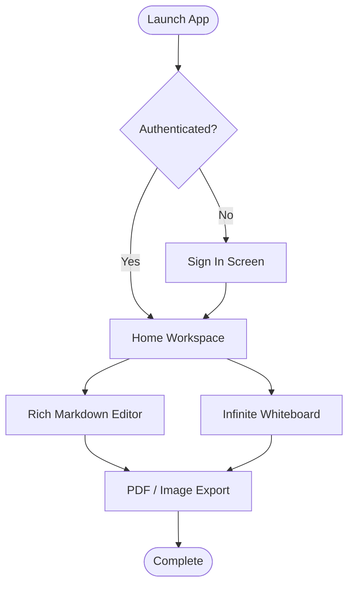
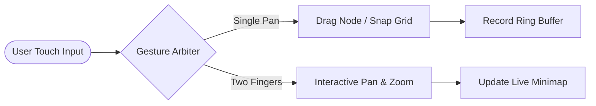

# Tack Comprehensive Markdown & Diagram Test

Welcome to the **Tack** comprehensive Markdown verification suite. This document tests all rendering capabilities including GitHub-style alerts, native Mermaid flowcharts, tables, tasks, and typography.

---

## 1. GitHub-Style Callout Alerts

> [!NOTE]
> This is a standard **Note** alert rendered in Tack's signature *Cyan Breeze* pastel palette.

> [!TIP]
> This is a **Tip** alert using the vibrant *Lime Zing* accent for helpful productivity recommendations.

> [!IMPORTANT]
> This is an **Important** alert rendered in *Lavender Mist* highlighting essential architectural instructions.

> [!WARNING]
> This is a **Warning** alert using *Warm Amber* to signal potential breaking changes or caution items.

> [!CAUTION]
> This is a **Caution** alert highlighted with *Coral Blush* for high-risk operations.

---

## 2. Interactive Flowcharts & Mermaid Diagrams

### 2.1 Vertical Top-to-Bottom Flowchart


### 2.2 Horizontal Left-to-Right Architecture


---

## 3. Data Tables

| Feature ID | Module | Status | Pastel Accent | Priority |
| :--- | :--- | :---: | :--- | ---: |
| **TK-01** | Whiteboard Canvas | Ready | Cyan Breeze | High |
| **TK-02** | Mermaid Flowcharts | Ready | Lime Zing | High |
| **TK-03** | Callout Alerts | Ready | Lavender Mist | Medium |
| **TK-04** | Clipboard History | Active | Sunset Peach | High |
| **TK-05** | PDF & Image Export | Ready | Warm Amber | Medium |

---

## 4. Interactive Task Lists

- [x] Fix branching coordinate clamp to 6000px canvas bounds
- [x] Create touch-friendly Edge Context Capsule (Edit, Reverse, Delete)
- [x] Consolidate scattered tools into unified bottom dock
- [x] Implement 20px snap-to-grid alignment
- [x] Add interactive Live Minimap radar navigator
- [x] Add distraction-free Zen Mode toggle
- [ ] Export note directly to cloud backup

---

## 5. Rich Typography & Styling

You can combine **bold text**, *italic text*, ***bold italic***, ~~strikethrough~~, `inline code`, and [clickable hyperlinks](https://flutter.dev).

### Nested Bulleted List:
- Core Themes
  - Dark Surface: `#121316`
  - Light Surface: `#F8F9FA`
  - Sticky Pastels:
    - *Sunset Peach*
    - *Lime Zing*
    - *Cyan Breeze*
- Font Hierarchy:
  - Font Family: `DM Sans`
  - Tracking: `-2%` letter spacing

### Numbered Steps:
1. Tap the **+** QuickAdd button or bottom dock.
2. Select your desired shape or sticky note color.
3. Drag items onto the canvas with snap-to-grid.
4. Tap **Export** for high-resolution PNG or PDF generation.

---

## 6. Syntax-Highlighted Code Blocks

```dart
// Dart Example: Canvas Node Definition
class CanvasNode {
  final String id;
  final String text;
  final CanvasNodeType shapeType;
  final double x;
  final double y;

  const CanvasNode({
    required this.id,
    required this.text,
    required this.shapeType,
    required this.x,
    required this.y,
  });
}
```

```python
# Python Example: Batch Process Snippet
def process_notes(notes):
    return [note.title.strip().upper() for note in notes if not note.is_trash]
```

---

## 7. Blockquotes

> "Simplicity is about subtracting the obvious and adding the meaningful."
> — *John Maeda, The Laws of Simplicity*
